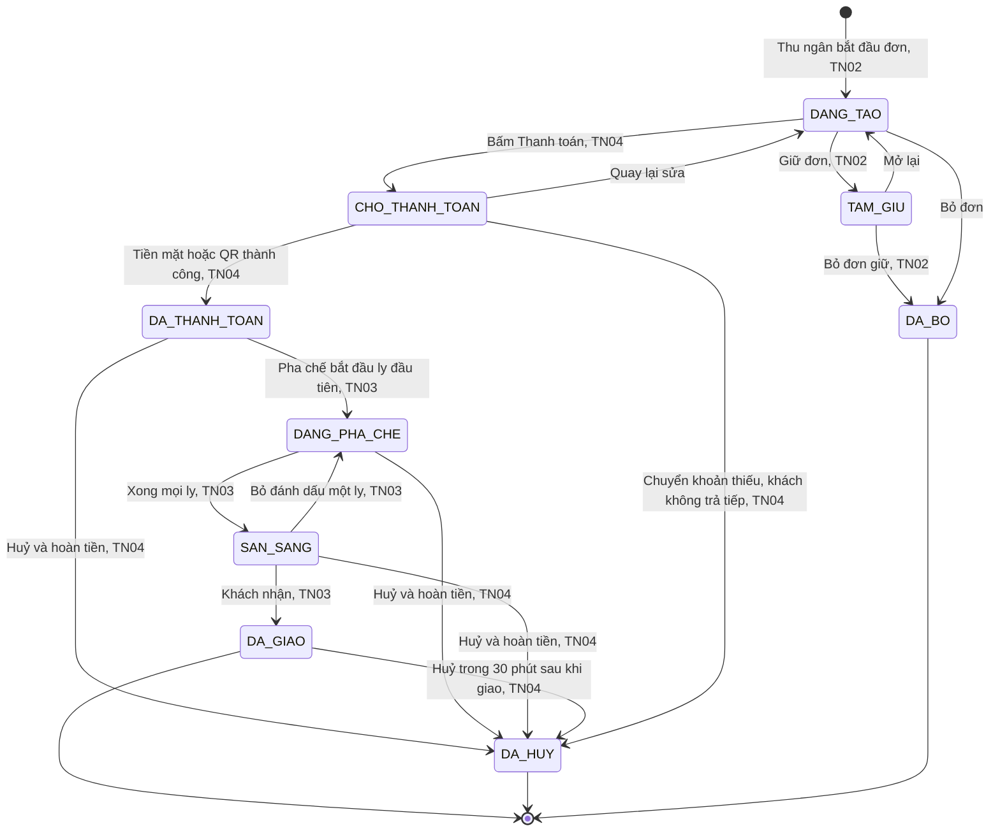
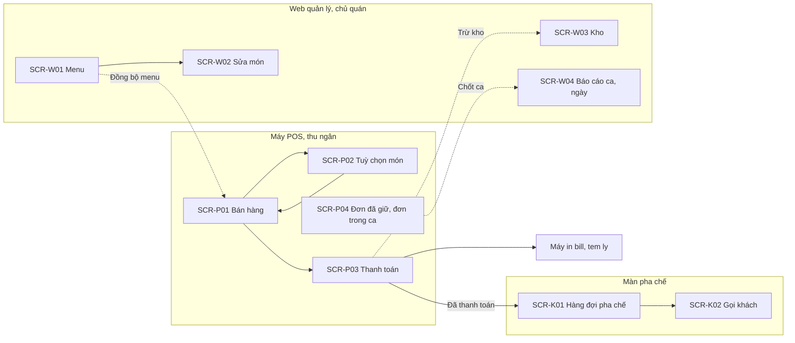

# Đề 6 · Quản lý đơn hàng quán trà sữa

> **Mã:** DE06 · **Độ khó:** 6/8 · **Vai trò:** 3 (thu ngân, pha chế, chủ quán) · **Nền tảng:** Máy POS (tablet) · Màn pha chế (tablet) · Web quản lý `[giả định]`

Hệ thống bán hàng cho một quán trà sữa: thu ngân nhận đơn tại quầy với món có nhiều tuỳ chọn, quầy pha chế nhận đơn ngay trên màn hình, khách thanh toán tiền mặt hoặc QR, kho nguyên liệu tự trừ theo công thức, chủ quán xem báo cáo ca. Đây là đề có **thao tác nhanh dưới áp lực giờ cao điểm** và **dữ liệu chảy qua nhiều màn hình cùng lúc**. Đề gồm 5 tính năng; mỗi tính năng có 1 PRD và 1 SRS riêng.

## Tính năng

| **Mã** | **Tính năng** | **Phạm vi** | **PRD** | **SRS** |
| --- | --- | --- | --- | --- |
| TN01 | Quản lý menu | Danh mục, món, size, nhóm tuỳ chọn (đường, đá, topping), giá, hết món, công thức | [PRD](docs/TN01-quan-ly-menu/PRD.md) | [SRS](docs/TN01-quan-ly-menu/SRS.md) |
| TN02 | Tạo đơn tại quầy | Chọn món, tuỳ chọn, số lượng, ghi chú, sửa giỏ, giữ đơn, số thứ tự | [PRD](docs/TN02-tao-don-tai-quay/PRD.md) | [SRS](docs/TN02-tao-don-tai-quay/SRS.md) |
| TN03 | Màn pha chế realtime | Đơn hiện ngay, thứ tự ưu tiên, đánh dấu từng ly, gọi khách, đơn trễ | [PRD](docs/TN03-man-pha-che/PRD.md) | [SRS](docs/TN03-man-pha-che/SRS.md) |
| TN04 | Thanh toán & in bill | Tiền mặt, QR chuyển khoản, đối soát, in bill và tem ly, huỷ và hoàn tiền | [PRD](docs/TN04-thanh-toan-in-bill/PRD.md) | [SRS](docs/TN04-thanh-toan-in-bill/SRS.md) |
| TN05 | Kho nguyên liệu & báo cáo ca | Tồn kho, trừ theo công thức, cảnh báo sắp hết, nhập kho, kiểm kê, mở và chốt ca, báo cáo | [PRD](docs/TN05-kho-bao-cao-ca/PRD.md) | [SRS](docs/TN05-kho-bao-cao-ca/SRS.md) |

Thứ tự làm gợi ý: TN01 → TN02 → TN04 → TN03 → TN05.

## Vòng đời đơn hàng (dùng chung cả đề)



Mỗi đơn chỉ vào màn pha chế **sau khi đã thanh toán** `[giả định]`. Kho bị trừ khi đơn `DA_THANH_TOAN` và được hoàn khi huỷ trước lúc pha chế (TN05).

## Kiến trúc màn hình



## Bối cảnh chung

Giờ cao điểm (trưa, sau giờ tan học) một quầy có thể nhận 60–100 đơn mỗi giờ `[giả định]`. Mỗi ly có size, mức đường, mức đá và nhiều topping, nên ghi sai là chuyện thường. Pha chế đọc phiếu viết tay dễ nhầm, khách không biết bao giờ tới lượt. Cuối ngày chủ quán khó biết thu bao nhiêu, nguyên liệu còn bao nhiêu.

| **Nhóm người dùng** | **Nhu cầu chính** |
| --- | --- |
| Thu ngân | Nhập đơn thật nhanh và đúng, thu tiền nhanh, ít bấm |
| Pha chế | Thấy rõ ly nào làm trước, công thức từng ly, không đọc nhầm |
| Chủ quán | Sửa menu và giá, biết doanh thu, nguyên liệu sắp hết, ca có thiếu tiền không |
| Khách | Ly đúng món, biết khi nào tới lượt |

Ngoài phạm vi cả đề: nhiều chi nhánh, giao hàng và đặt online, ứng dụng đặt món cho khách, tích điểm thành viên, khuyến mãi phức tạp (chỉ có giảm giá đơn), chấm công nhân viên, kết nối máy POS ngân hàng (quẹt thẻ).

## Quy ước dùng chung

- Màn POS mã `SCR-P..`, màn pha chế `SCR-K..`, Web quản lý `SCR-W..`.
- Tiền tệ VND, không có số lẻ.
- Mỗi nhân viên đăng nhập POS bằng mã PIN 4 số; quyền theo vai trò: thu ngân, pha chế, chủ quán `[giả định]`.
- Mã BR, MSG, UC đánh số liên tục trong cả đề: TN01 dùng BR-01–10, MSG-01–08; TN02 dùng BR-11–22, MSG-09–16; TN03 dùng BR-23–32, MSG-17–22; TN04 dùng BR-33–45, MSG-23–34; TN05 dùng BR-46–58, MSG-35–44.
- Giá trị đánh dấu `[giả định]` dùng để dựng flow, cần PO hoặc BA xác nhận trước khi dùng.

## Danh sách màn hình

| **Mã** | **Màn hình** | **Nền tảng** | **Mô tả chi tiết ở** |
| --- | --- | --- | --- |
| SCR-W01 | Menu | Web quản lý | SRS TN01 |
| SCR-W02 | Sửa món | Web quản lý | SRS TN01 |
| SCR-P01 | Bán hàng | POS | SRS TN02 |
| SCR-P02 | Tuỳ chọn món | POS | SRS TN02 |
| SCR-P04 | Đơn đã giữ, đơn trong ca | POS | SRS TN02 |
| SCR-K01 | Hàng đợi pha chế | Màn pha chế | SRS TN03 |
| SCR-K02 | Gọi khách | Màn pha chế, màn khách | SRS TN03 |
| SCR-P03 | Thanh toán | POS | SRS TN04 |
| SCR-P05 | Huỷ đơn & hoàn tiền | POS | SRS TN04 |
| SCR-W03 | Kho | Web quản lý | SRS TN05 |
| SCR-P06 | Mở ca, chốt ca | POS | SRS TN05 |
| SCR-W04 | Báo cáo ca, ngày | Web quản lý | SRS TN05 |

## Cấu trúc repo

```text
de06-quan-ly-don-tra-sua/
├── README.md
└── docs/
    ├── TN01-quan-ly-menu/        PRD.md · SRS.md
    ├── TN02-tao-don-tai-quay/    PRD.md · SRS.md
    ├── TN03-man-pha-che/         PRD.md · SRS.md
    ├── TN04-thanh-toan-in-bill/  PRD.md · SRS.md
    └── TN05-kho-bao-cao-ca/      PRD.md · SRS.md
```

## Cách dùng bộ tài liệu

1. Đọc README để nắm vòng đời đơn hàng và màn nào thấy đơn ở bước nào.
2. Với mỗi tính năng: đọc PRD, rồi SRS. Thiết kế cho **giờ cao điểm**: ít chạm, chữ to, không popup thừa.
3. Thiết kế màn hình theo đúng mã SCR, mã MSG trong SRS để dễ đối chiếu khi review.
4. Sơ đồ viết bằng Mermaid, xem trực tiếp trên GitHub hoặc trình xem Markdown có hỗ trợ Mermaid.
