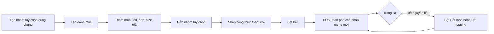

> **Mã:** DE06-TN01-PRD · **Trạng thái:** nháp · **Người viết:** Design (mock) · **SRS:** [SRS.md](SRS.md)

# PRD Quản lý menu (Quản lý đơn hàng quán trà sữa)

> **Bản mock.** Con số đánh dấu `[giả định]` dùng để dựng flow, cần PO xác nhận trước khi dùng.

## 1. Bối cảnh và vấn đề

### 1.1 Bối cảnh

Menu là dữ liệu gốc của cả hệ thống: thu ngân bán theo menu ([TN02](../TN02-tao-don-tai-quay/PRD.md)), pha chế làm theo tuỳ chọn trong menu ([TN03](../TN03-man-pha-che/PRD.md)), kho trừ theo công thức gắn với món ([TN05](../TN05-kho-bao-cao-ca/PRD.md)). Một ly trà sữa có thể có hàng chục tổ hợp size, đường, đá, topping. Chủ quán cần sửa menu nhanh mà không làm rối máy POS đang bán.

### 1.2 Vấn đề

| **Vấn đề** | **Hệ quả** |
| --- | --- |
| Mỗi tổ hợp size, topping là một món riêng | Menu phình to, thu ngân tìm lâu |
| Đổi giá phải sửa từng món | Sai giá giữa các món, quên sửa |
| Hết nguyên liệu nhưng vẫn bán được món | Thu tiền rồi mới báo hết, khách bực |
| Tuỳ chọn không giới hạn (chọn 6 topping) | Ly không pha được, sai giá |
| Không gắn công thức với món | Không trừ kho tự động được |

### 1.3 Mục tiêu

- Thêm một món mới hoàn chỉnh (size, tuỳ chọn, giá) trong ≤ 3 phút `[giả định]`.
- Bật, tắt "hết món" có hiệu lực trên POS trong ≤ 10 giây `[giả định]`.
- 100% món đang bán có công thức để trừ kho.

## 2. Người dùng

| **Nhóm** | **Nhu cầu với tính năng này** |
| --- | --- |
| Chủ quán | Thêm món theo mùa, đổi giá, cấu hình topping dùng chung |
| Quản lý ca | Báo hết món, hết topping ngay trong ca |
| Thu ngân (gián tiếp) | Menu gọn, sắp xếp theo món bán chạy |

## 3. Phạm vi

### 3.1 Trong phạm vi (MVP)

- Danh mục (Trà sữa, Trà trái cây, Cà phê…), sắp xếp danh mục và món.
- Món: tên, ảnh, mô tả ngắn, danh mục, size và giá theo size.
- Nhóm tuỳ chọn dùng chung nhiều món: Mức đường, Mức đá, Topping; chọn một hoặc chọn nhiều, giới hạn số lượng, giá cộng thêm.
- Bật, tắt bán: hết món, hết một tuỳ chọn (ví dụ hết trân châu trắng).
- Công thức theo size: lượng nguyên liệu cho mỗi ly; công thức của topping.
- Đồng bộ menu sang POS và màn pha chế.

### 3.2 Ngoài phạm vi

- Combo, món tặng kèm → phase sau.
- Giá theo khung giờ (giờ vàng).
- Menu khác nhau giữa các chi nhánh.
- Nhập menu từ file.

## 4. Nguyên tắc sản phẩm

### 4.1 Một món, nhiều tuỳ chọn

Một món có nhiều size và tuỳ chọn, không tách thành nhiều món. Nhóm tuỳ chọn dùng chung để sửa một lần áp dụng cho mọi món.

### 4.2 Không bán thứ không có

Hết món hay hết tuỳ chọn thì POS không cho chọn. Thay đổi lan sang máy đang bán trong vài giây.

### 4.3 Thay đổi an toàn khi đang bán

Đổi giá không ảnh hưởng đơn đang tạo dở. Món đang có trong đơn chưa xong không xoá được, chỉ ẩn được.

### 4.4 Công thức đi cùng món

Món mới chưa có công thức thì cảnh báo chủ quán, để báo cáo kho không sai.

## 5. Quy tắc nghiệp vụ

| **Quy tắc** | **Giá trị** `[giả định]` |
| --- | --- |
| Size | 1–3 size mỗi món (M, L, XL), mỗi size một giá |
| Mức đường | 0%, 30%, 50%, 70%, 100% (mặc định 100%), chọn 1 |
| Mức đá | Không đá, Ít đá, Bình thường (mặc định), Nhiều đá, chọn 1 |
| Topping | Chọn 0–3, mỗi topping tối đa 2 phần, giá cộng thêm |
| Giá | Số nguyên VND, bội số 1.000 |
| Hết món, hết tuỳ chọn | Có hiệu lực tới khi bật lại, hoặc tự bật lại khi mở ca đầu tiên của ngày hôm sau |
| Xoá món | Chỉ khi không có trong đơn chưa xong; món đã bán vẫn giữ trong báo cáo |
| Công thức | Theo size; đơn vị gram, ml, cái |

- Các giá trị trên là **cấu hình theo quán**, không cố định trong code.

## 6. Luồng trải nghiệm

| **Bước** | **Giai đoạn** | **Trải nghiệm** | **Đầu ra** |
| --- | --- | --- | --- |
| 1 | Thiết lập | Tạo nhóm Mức đường, Mức đá, Topping dùng chung | Nhóm tuỳ chọn |
| 2 | Thêm món | Form một trang: thông tin, size và giá, nhóm tuỳ chọn, công thức | Món mới |
| 3 | Xem trước | Món hiện như trên POS | Kiểm tra trước khi bán |
| 4 | Bật bán | Bật công tắc Đang bán | Món có trên POS |
| 5 | Trong ca | Quản lý ca bật Hết món từ POS hoặc Web | POS chặn chọn |
| 6 | Đổi giá | Sửa giá theo size; áp dụng cho đơn mới | Giá mới |

## 7. Use Cases, User Stories và Acceptance Criteria

### UC1. Thiết lập menu

#### US1.1 Tạo nhóm tuỳ chọn dùng chung

User Story: Là chủ quán, tôi muốn tạo nhóm topping một lần và gắn cho nhiều món để không phải nhập lại.

AC01: Nhóm tuỳ chọn có tên, kiểu chọn (một / nhiều), số lượng tối thiểu, tối đa, lựa chọn mặc định.

AC02: Mỗi lựa chọn có tên, giá cộng thêm (có thể 0 ₫), công thức (với topping).

AC03: Sửa nhóm → áp dụng cho mọi món đang gắn nhóm, có báo số món bị ảnh hưởng.

#### US1.2 Thêm và sửa món

User Story: Là chủ quán, tôi muốn thêm món với size, giá, tuỳ chọn để bán được ngay trên POS.

AC01: Món có tên, ảnh, mô tả ngắn, danh mục, 1–3 size với giá từng size.

AC02: Gắn nhóm tuỳ chọn và thứ tự hiện trên POS.

AC03: Xem trước món như trên POS.

AC04: Món chưa có công thức → cảnh báo, vẫn cho bật bán khi chủ quán xác nhận.

AC05: Sắp xếp món trong danh mục bằng kéo thả; có gợi ý "Sắp theo bán chạy tuần trước".

### UC2. Bật, tắt bán trong ca

#### US2.1 Báo hết món hoặc hết tuỳ chọn

User Story: Là quản lý ca, tôi muốn báo hết món ngay khi hết nguyên liệu để thu ngân không bán nhầm.

AC01: Bật Hết món từ Web hoặc từ POS (vai trò quản lý ca, chủ quán).

AC02: POS hiện món mờ, nhãn "Hết", không chọn được, trong ≤ 10 giây.

AC03: Hết một tuỳ chọn (ví dụ trân châu trắng) → mọi món có tuỳ chọn đó vẫn bán, chỉ tuỳ chọn bị khoá.

AC04: Mở ca đầu tiên của ngày hôm sau thì tự bật lại (ca thứ hai trong cùng ngày không tự bật); có danh sách "Đang hết" để bật lại thủ công.

### UC3. Đổi giá và xoá món

AC01: Đổi giá áp dụng cho món được thêm vào giỏ sau thời điểm lưu. Trong đơn đang tạo dở, dòng đã có trong giỏ giữ giá cũ, dòng thêm sau đó tính giá mới.

AC02: Xoá món đang có trong đơn chưa xong → không cho, gợi ý ẩn món.

AC03: Món đã xoá hoặc ẩn vẫn hiện đúng tên, giá trong báo cáo cũ.

## 8. Chỉ số theo dõi `[giả định]`

| **Chỉ số** | **Định nghĩa** | **Mục tiêu MVP** |
| --- | --- | --- |
| Thời gian thêm món | Từ mở form tới lưu | ≤ 3 phút (trung vị) |
| Độ trễ đồng bộ | Từ lưu trên Web tới POS cập nhật | ≤ 10 giây |
| Tỉ lệ món có công thức | Món đang bán có công thức / món đang bán | 100% |
| Số lần báo hết mỗi ca | Lượt bật Hết món, Hết tuỳ chọn | Theo dõi |
| Đơn bị huỷ vì hết món | Đơn huỷ lý do hết món / tổng đơn | ≤ 0,5% |

## 9. Phụ thuộc và rủi ro

| **Mục** | **Mô tả** | **Hướng xử lý** |
| --- | --- | --- |
| POS mất mạng | Không nhận thay đổi menu | POS dùng menu đã lưu; đồng bộ khi có mạng; báo "Menu chưa cập nhật" |
| Sửa nhóm tuỳ chọn ảnh hưởng nhiều món | Sửa nhầm giá topping cho mọi món | Báo số món ảnh hưởng, xác nhận trước khi lưu |
| Công thức sai | Báo cáo kho sai | Cảnh báo khi kho lệch nhiều sau kiểm kê (TN05) |
| Ảnh món nặng | POS tải chậm | Nén ảnh khi tải lên |

## 10. Câu hỏi mở

> Câu nào đã có giá trị ở mục 5 thì giá trị đó là **tạm chốt** `[giả định]` để dựng flow. Câu hỏi vẫn để mở cho đến khi PO xác nhận.

- Thu ngân có được báo hết món không, hay chỉ quản lý ca?
- Có cần giá khác nhau cho từng mức đá, đường (ví dụ "Không đường" giảm giá)?
- Số topping tối đa là 3 hay cho mỗi món tự cấu hình?
- Hết món có tự bật lại mỗi đầu ca không?
