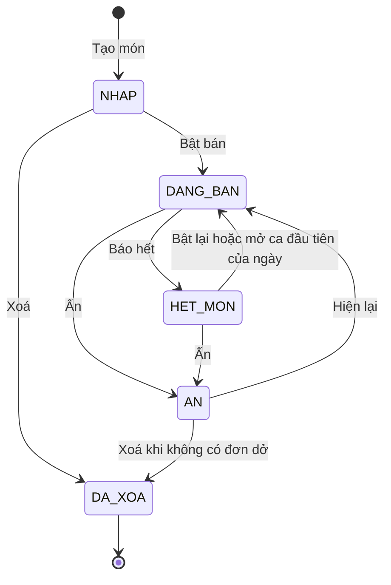
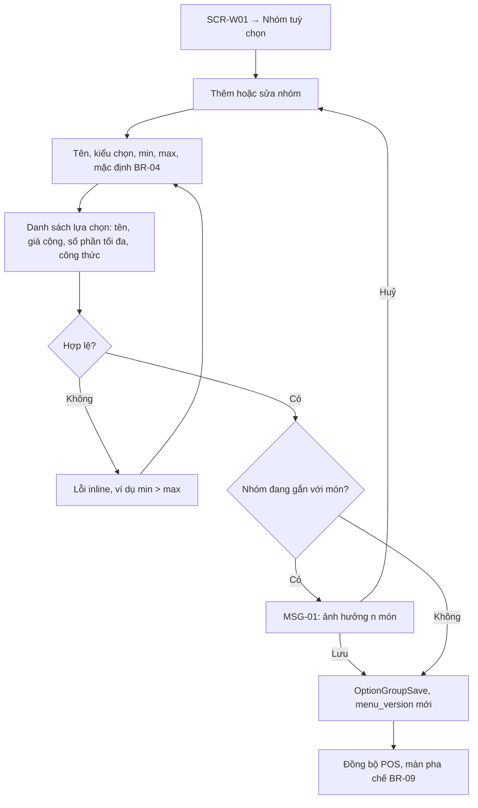
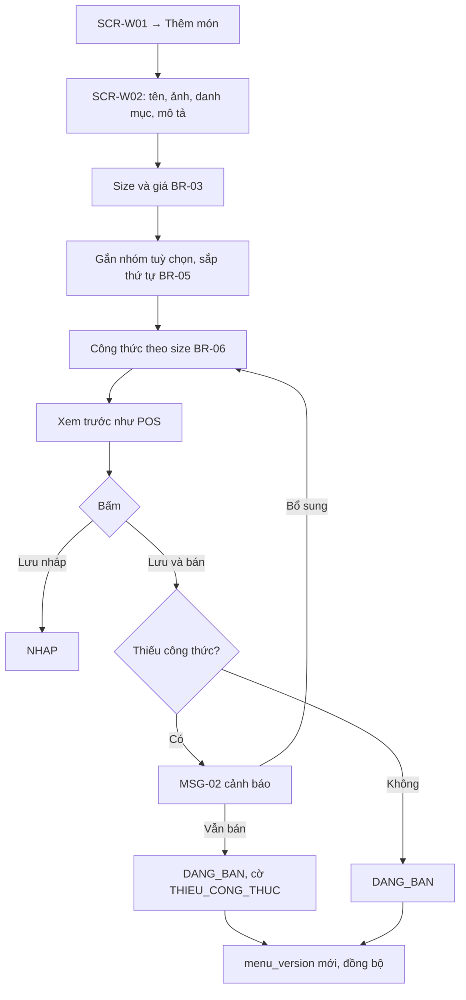
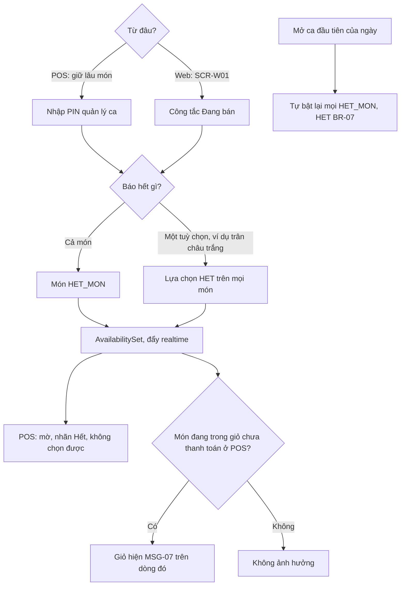
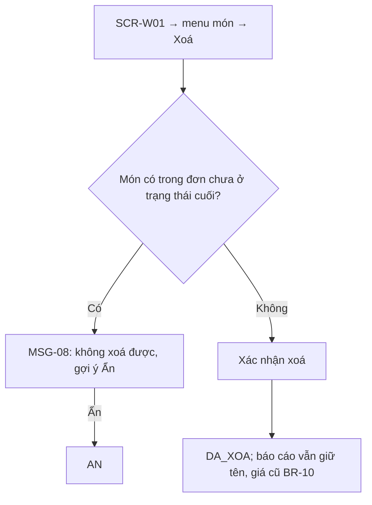
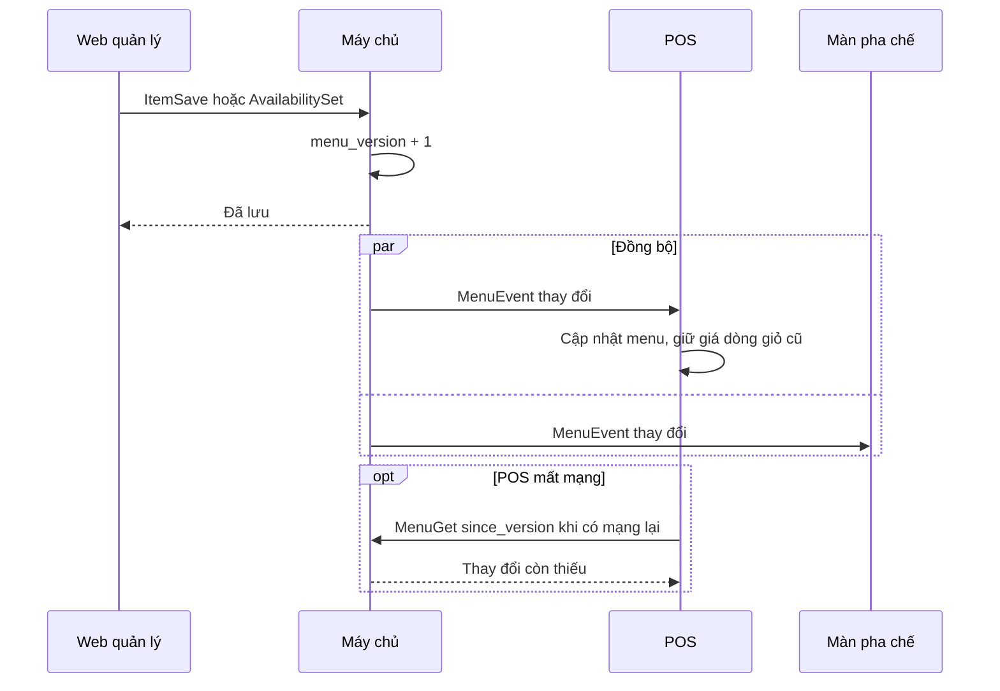

> **Mã:** DE06-TN01-SRS · **Trạng thái:** đã chốt · **Người viết:** Design · **PRD:** [PRD.md](PRD.md)

# UC-DE06-01 - Quản lý menu

> Bán theo menu xem [SRS TN02](../TN02-tao-don-tai-quay/SRS.md); công thức dùng để trừ kho xem [SRS TN05](../TN05-kho-bao-cao-ca/SRS.md).

## 1. Tổng quan

| **Mục** | **Nội dung** |
| --- | --- |
| Mục tiêu | Chủ quán cấu hình danh mục, món, size, nhóm tuỳ chọn, giá, công thức; quản lý ca bật tắt bán trong ca |
| Actor | Chủ quán · Quản lý ca · Web quản lý · POS · Màn pha chế · Máy chủ |
| Phạm vi | Danh mục, món, size, nhóm tuỳ chọn, công thức, bật tắt bán, đổi giá, ẩn, xoá, đồng bộ |
| Ngoài phạm vi | Combo, giá theo giờ, menu nhiều chi nhánh, nhập từ file |
| Nền tảng | Web quản lý; POS (bật tắt bán) |

## 2. User Story

| **ID** | **As a** | **I want** | **So that** |
| --- | --- | --- | --- |
| US-01 | Chủ quán | Tạo nhóm tuỳ chọn dùng chung | Sửa một lần cho mọi món |
| US-02 | Chủ quán | Thêm món với size, giá, tuỳ chọn, công thức | Bán được và trừ kho đúng |
| US-03 | Quản lý ca | Báo hết món, hết tuỳ chọn ngay | Thu ngân không bán nhầm |
| US-04 | Chủ quán | Đổi giá mà không ảnh hưởng đơn đang tạo | Không lệch tiền |
| US-05 | Chủ quán | Ẩn, xoá món an toàn | Báo cáo cũ không sai |

## 3. Business Rules

| **Mã** | **Quy tắc** |
| --- | --- |
| BR-01 | **Danh mục**: tên 1–30 ký tự, không trùng; tối đa 20 danh mục; có thứ tự |
| BR-02 | **Món**: tên 1–50 ký tự, không trùng trong quán; thuộc đúng 1 danh mục; ảnh ≤ 2 MB (nén còn ≤ 200 KB); mô tả ≤ 100 ký tự |
| BR-03 | **Size**: 1–3 size mỗi món, tên size từ danh sách quán (M, L, XL); giá từng size là bội số 1.000, từ 1.000 đến 500.000 ₫ |
| BR-04 | **Nhóm tuỳ chọn**: tên, kiểu `CHON_MOT` hoặc `CHON_NHIEU`, min, max (`CHON_MOT`: min = max = 1), mặc định (bắt buộc với `CHON_MOT`). Lựa chọn: tên, giá cộng thêm (0–50.000 ₫), số phần tối đa mỗi lựa chọn (1–2) |
| BR-05 | **Gắn nhóm vào món**: tối đa 5 nhóm mỗi món, có thứ tự hiển thị. Một nhóm gắn được nhiều món |
| BR-06 | **Công thức món** theo size: danh sách (nguyên liệu, lượng, đơn vị). **Công thức tuỳ chọn**: lượng cho 1 phần (ví dụ trân châu 50 g). Thiếu công thức → món có cờ `THIEU_CONG_THUC` |
| BR-07 | **Trạng thái bán**: món `DANG_BAN`, `HET_MON`, `AN`; lựa chọn `CON`, `HET`. `HET_MON` và `HET` tự về `DANG_BAN`/`CON` khi mở **ca đầu tiên của ngày** (ngày mở ca khác ngày mở của ca liền trước); mở ca thứ hai trong cùng ngày không tự bật lại |
| BR-08 | **Quyền**: chủ quán sửa mọi thứ; quản lý ca chỉ bật tắt `HET_MON`, `HET` (từ POS hoặc Web); thu ngân, pha chế chỉ xem |
| BR-09 | **Phiên bản menu**: mỗi lần lưu tạo `menu_version` mới; POS, màn pha chế nhận qua kết nối realtime ≤ 10 giây. Đơn đang tạo giữ giá theo phiên bản lúc thêm món vào giỏ (TN02) |
| BR-10 | **Xoá món** chỉ khi không có trong đơn chưa ở trạng thái cuối; nếu có → gợi ý `AN`. Món đã xoá giữ tên, giá trong đơn cũ và báo cáo (dữ liệu chụp vào dòng đơn) |

## 4. Trạng thái

### 4.1 Trạng thái món

| **Trạng thái** | **POS** | **Báo cáo** |
| --- | --- | --- |
| `NHAP` | Không hiện | – |
| `DANG_BAN` | Hiện, chọn được | Có |
| `HET_MON` | Hiện mờ, nhãn "Hết", không chọn được | Có |
| `AN` | Không hiện | Có (dữ liệu cũ) |
| `DA_XOA` | Không hiện | Có (dữ liệu cũ) |

## 5. Use Case

### UC-01 Tạo, sửa nhóm tuỳ chọn

| **Mục** | **Nội dung** |
| --- | --- |
| Tiền điều kiện | Chủ quán đăng nhập Web |
| Hậu điều kiện | Nhóm được lưu; menu_version mới; POS cập nhật |

**Luồng chính**

| **Bước** | **Actor** | **Mô tả** |
| --- | --- | --- |
| 1 | Chủ quán | **SCR-W01** → Nhóm tuỳ chọn → thêm hoặc sửa nhóm |
| 2 | Chủ quán | Nhập tên, kiểu chọn, min, max, mặc định (BR-04) |
| 3 | Chủ quán | Nhập danh sách lựa chọn: tên, giá cộng, số phần tối đa, công thức |
| 4 | Hệ thống | Kiểm tra hợp lệ |
| 5 | Hệ thống | Gọi \[OptionGroupSave\], tạo `menu_version` mới |
| 6 | Hệ thống | Đồng bộ POS và màn pha chế (BR-09) |

**Luồng thay thế**

| **Mã** | **Điều kiện** | **Xử lý** |
| --- | --- | --- |
| A1 | Nhóm đang gắn với món | MSG-01 báo số món bị ảnh hưởng; chọn Lưu → bước 5, chọn Huỷ → quay lại sửa |

**Luồng lỗi**

| **Mã** | **Điều kiện** | **Xử lý** |
| --- | --- | --- |
| E1 | Dữ liệu không hợp lệ, ví dụ min > max | Lỗi inline, không lưu |
| E2 | Lưu thất bại | Báo lỗi, giữ nội dung đang sửa, cho thử lại |

### UC-02 Thêm, sửa món

| **Mục** | **Nội dung** |
| --- | --- |
| Tiền điều kiện | Có ít nhất 1 danh mục |
| Hậu điều kiện thành công | Món lưu ở `NHAP` hoặc `DANG_BAN` |
| Hậu điều kiện thất bại | Không lưu; dữ liệu giữ trên form |

**Luồng chính**

| **Bước** | **Actor** | **Mô tả** |
| --- | --- | --- |
| 1 | Chủ quán | **SCR-W01** → "Thêm món" |
| 2 | Chủ quán | Điền thông tin (BR-02), size và giá (BR-03) |
| 3 | Chủ quán | Gắn nhóm tuỳ chọn (BR-05); nhập công thức từng size (BR-06) |
| 4 | Chủ quán | Xem trước; bấm "Lưu và bán" |
| 5 | Web | Kiểm tra; thiếu công thức → MSG-02 |
| 6 | Máy chủ | Lưu, tạo menu_version (BR-09), đẩy cập nhật |

**Luồng thay thế**

| **Mã** | **Điều kiện** | **Xử lý** |
| --- | --- | --- |
| A1 | Sửa giá món đang bán | Áp dụng cho dòng giỏ thêm sau thời điểm lưu (BR-09); MSG-03 |
| A2 | Nhân bản món | Mở **SCR-W02** với dữ liệu món cũ, tên thêm "(bản sao)", trạng thái `NHAP` |
| A3 | Đổi danh mục | Món chuyển xuống cuối danh mục mới |

**Luồng lỗi**

| **Mã** | **Điều kiện** | **Xử lý** |
| --- | --- | --- |
| E1 | Tên trùng | MSG-04 |
| E2 | Giá không phải bội số 1.000 | MSG-05 |
| E3 | Ảnh quá lớn hoặc sai định dạng | MSG-06 |

### UC-03 Bật, tắt bán trong ca

| **Mục** | **Nội dung** |
| --- | --- |
| Tiền điều kiện | Người dùng là quản lý ca hoặc chủ quán (BR-08) |
| Hậu điều kiện | Món `HET_MON` hoặc lựa chọn `HET`; POS khoá chọn trong ≤ 10 giây |

**Luồng chính**

| **Bước** | **Actor** | **Mô tả** |
| --- | --- | --- |
| 1 | Quản lý ca | Trên POS, giữ lâu vào món và nhập PIN quản lý ca |
| 2 | Quản lý ca | Chọn báo hết cả món hoặc một tuỳ chọn |
| 3 | Hệ thống | Món `HET_MON`, hoặc lựa chọn `HET` trên mọi món |
| 4 | Hệ thống | Gọi \[AvailabilitySet\], đẩy realtime |
| 5 | Hệ thống | POS hiện mờ kèm nhãn "Hết", không chọn được |

**Luồng thay thế**

| **Mã** | **Điều kiện** | **Xử lý** |
| --- | --- | --- |
| A1 | Chủ quán thao tác trên Web | Dùng công tắc "Đang bán" ở **SCR-W01**, không cần PIN |
| A2 | Món vừa hết đang nằm trong giỏ chưa thanh toán | Dòng đó trong giỏ hiện MSG-07 |
| A3 | Mở ca đầu tiên của ngày | Tự bật lại mọi `HET_MON`, `HET` (BR-07); ca sau trong cùng ngày giữ nguyên danh sách "Đang hết" |

**Luồng lỗi**

| **Mã** | **Điều kiện** | **Xử lý** |
| --- | --- | --- |
| E1 | PIN sai hoặc không đủ quyền | MSG-12 (SRS TN02), không đổi trạng thái |

### UC-04 Ẩn, xoá món

| **Mục** | **Nội dung** |
| --- | --- |
| Tiền điều kiện | Chủ quán đăng nhập Web quản lý; món đang `DANG_BAN`, `HET_MON` (để ẩn) hoặc `NHAP`, `AN` (để xoá) |
| Hậu điều kiện | Món `AN` hoặc `DA_XOA`; báo cáo cũ vẫn giữ tên, giá (BR-10) |

**Luồng chính**

| **Bước** | **Actor** | **Mô tả** |
| --- | --- | --- |
| 1 | Chủ quán | **SCR-W01** → menu của món → Xoá |
| 2 | Hệ thống | Kiểm tra món không nằm trong đơn chưa ở trạng thái cuối |
| 3 | Hệ thống | Hỏi xác nhận xoá |
| 4 | Chủ quán | Xác nhận |
| 5 | Hệ thống | Món `DA_XOA`; báo cáo cũ vẫn giữ tên, giá (BR-10) |

**Luồng thay thế**

| **Mã** | **Điều kiện** | **Xử lý** |
| --- | --- | --- |
| A1 | Chọn Ẩn thay cho Xoá | Món `AN`: không hiện trên POS, vẫn giữ trong menu |

**Luồng lỗi**

| **Mã** | **Điều kiện** | **Xử lý** |
| --- | --- | --- |
| E1 | Món đang có trong đơn chưa hoàn tất | MSG-08: không xoá được, gợi ý Ẩn |

## 6. Điểm vào

| **Điểm vào** | **Dẫn tới** | **Ghi chú** |
| --- | --- | --- |
| Web quản lý → Menu | **SCR-W01** | |
| "Thêm món", chạm món | UC-02, **SCR-W02** | |
| Tab Nhóm tuỳ chọn ở **SCR-W01** | UC-01 | |
| Giữ lâu món trên **SCR-P01** | UC-03 | Cần PIN quản lý ca |
| Danh sách "Đang hết" ở **SCR-W01** | UC-03 bật lại | |

## 7. Mô tả màn hình

### SCR-W01 Menu (Web)

| **#** | **Thành phần** | **Loại** | **Hành vi** |
| --- | --- | --- | --- |
| 1 | Tab | Tabs | Món · Nhóm tuỳ chọn · Danh mục · Đang hết |
| 2 | Danh mục | Sidebar | Kéo thả thứ tự; số món |
| 3 | Bảng món | Table | Ảnh, tên, giá theo size, nhóm tuỳ chọn, trạng thái, cờ "Thiếu công thức", công tắc Đang bán |
| 4 | Hành động | Menu | Sửa, Nhân bản, Ẩn, Xoá |
| 5 | Thêm món | Button | Mở **SCR-W02** |
| 6 | Sắp theo bán chạy | Button | Gợi ý thứ tự theo số ly tuần trước |
| 7 | Trạng thái đồng bộ | Text phụ | "Đã đồng bộ tới {n} thiết bị lúc {giờ}" |

### SCR-W02 Sửa món (Web)

| **#** | **Thành phần** | **Loại** | **Bắt buộc** | **Validate / hành vi** |
| --- | --- | --- | --- | --- |
| 1 | Tên, ảnh, mô tả | Text, upload | Tên: có | BR-02 |
| 2 | Danh mục | Select | Có | |
| 3 | Size và giá | Bảng 1–3 dòng | Có | BR-03; MSG-05 |
| 4 | Nhóm tuỳ chọn | Multi-select có thứ tự | Không | BR-05; xem nhanh lựa chọn của nhóm |
| 5 | Công thức | Bảng theo size | Không (cảnh báo) | Nguyên liệu (từ kho TN05), lượng, đơn vị |
| 6 | Xem trước POS | Panel | – | Thẻ món và màn tuỳ chọn như **SCR-P02** |
| 7 | Lưu nháp · Lưu và bán | Buttons | – | MSG-02 khi thiếu công thức |

## 8. API

| **API** | **Request chính** | **Response chính** | **Timeout / retry** |
| --- | --- | --- | --- |
| \[MenuGet\] | store_id, since_version | Danh mục, món, nhóm tuỳ chọn, trạng thái bán, menu_version | 5s / 2 lần |
| \[CategorySave\] | Danh mục, thứ tự | – | 5s / 2 lần |
| \[ItemSave\] | Món, size, giá, nhóm, công thức, status | item_id, menu_version, flags | 5s / 2 lần |
| \[OptionGroupSave\] | Nhóm, lựa chọn | group_id, menu_version, affected_items | 5s / 2 lần |
| \[AvailabilitySet\] | item_id hoặc option_id, status, actor_pin | menu_version | 3s / 2 lần |
| \[ItemDelete\] | item_id | deleted hoặc lỗi IN_USE | 5s / 1 lần |
| \[MenuEvent\] (máy chủ → POS, pha chế) | menu_version, thay đổi | – | Kết nối realtime |

**Map lỗi → thông báo**

| **Nhóm lỗi** | **Message** |
| --- | --- |
| Trùng tên món | MSG-04 |
| Giá không hợp lệ | MSG-05 |
| Ảnh sai định dạng hoặc quá dung lượng | MSG-06 |
| Xoá món còn trong đơn chưa hoàn tất | MSG-08 |
| Món hoặc tuỳ chọn vừa hết khi đang bán | MSG-07 |
| Lưu menu thất bại | Thông báo lỗi chung của app (ngoài bộ MSG của SRS này), cho thử lại; giữ nội dung đang sửa |

## 9. Danh sách thông báo

| **ID** | **Nơi hiện** | **Nội dung (VI)** |
| --- | --- | --- |
| MSG-01 | Popup | Nhóm "{tên}" đang gắn với {n} món. Thay đổi sẽ áp dụng cho tất cả. \[Huỷ\] \[Lưu\] |
| MSG-02 | Popup | Món chưa có công thức nên kho sẽ không tự trừ. \[Bổ sung công thức\] \[Vẫn bán\] |
| MSG-03 | Toast | Đã lưu giá mới, áp dụng cho các đơn tạo từ bây giờ |
| MSG-04 | Inline | Đã có món tên này |
| MSG-05 | Inline | Giá cần là bội số của 1.000 ₫ |
| MSG-06 | Inline | Ảnh cần là JPG hoặc PNG, tối đa 2 MB |
| MSG-07 | Inline giỏ POS | {Món / tuỳ chọn} vừa hết. Vui lòng đổi món hoặc bỏ khỏi đơn |
| MSG-08 | Popup | Món đang có trong đơn chưa hoàn tất nên chưa thể xoá. Bạn có thể ẩn món. \[Ẩn món\] \[Huỷ\] |

## 10. Yêu cầu phi chức năng

| **Mục** | **Yêu cầu** |
| --- | --- |
| Hiệu năng | Đồng bộ thay đổi tới POS ≤ 10 giây; **SCR-W01** ≤ 2 giây với 200 món |
| Offline | POS dùng menu đã lưu khi mất mạng; hiện "Menu chưa cập nhật" khi chênh phiên bản |
| Toàn vẹn | Dòng đơn lưu bản chụp tên, size, tuỳ chọn, giá tại thời điểm bán |
| Audit | Ghi nhật ký đổi giá, bật tắt bán: ai, lúc nào, giá trị cũ, mới |
| Bảo mật | Chỉ chủ quán sửa menu và giá; quản lý ca chỉ báo hết món, hết tuỳ chọn; mọi thao tác yêu cầu đăng nhập |
| Tracking | Thêm, sửa món; đổi giá; bật tắt bán (nguồn POS hay Web); món thiếu công thức |
| Accessibility | Công tắc có nhãn chữ "Đang bán / Hết"; bảng dùng được bằng bàn phím; kéo thả có thao tác thay thế |
