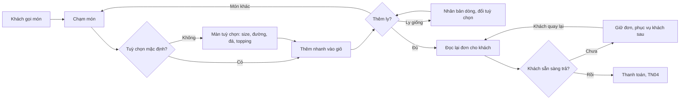

> **Mã:** DE06-TN02-PRD · **Trạng thái:** nháp · **Người viết:** Design (mock) · **SRS:** [SRS.md](SRS.md)

# PRD Tạo đơn tại quầy (Quản lý đơn hàng quán trà sữa)

> **Bản mock.** Con số đánh dấu `[giả định]` dùng để dựng flow, cần PO xác nhận trước khi dùng.

## 1. Bối cảnh và vấn đề

### 1.1 Bối cảnh

Thu ngân đứng quầy, khách gọi món bằng miệng, hàng người phía sau đang chờ. Mỗi ly có size, mức đường, mức đá, topping, ghi chú. Màn bán hàng trên POS là nơi thu ngân dành gần hết thời gian ca làm; mỗi giây tiết kiệm được nhân lên với hàng trăm đơn mỗi ngày.

### 1.2 Vấn đề

| **Vấn đề** | **Hệ quả** |
| --- | --- |
| Tìm món lâu khi menu dài | Hàng chờ dài giờ cao điểm |
| Phải chọn lại đường, đá cho mỗi ly dù khách chọn mặc định | Thừa chạm, chậm |
| Nhóm bạn gọi nhiều ly giống nhau, khác topping | Nhập lại từ đầu từng ly |
| Khách đổi ý giữa chừng | Xoá đơn làm lại |
| Khách chưa quyết định, đứng chắn quầy | Không phục vụ được khách sau |
| Ghi nhầm tuỳ chọn | Pha sai, làm lại, tốn nguyên liệu |

### 1.3 Mục tiêu

- Nhập một ly với tuỳ chọn mặc định trong ≤ 3 chạm; ly có tuỳ chọn riêng ≤ 6 chạm `[giả định]`.
- Thời gian nhập đơn trung vị ≤ 30 giây với đơn 2 ly `[giả định]`.
- Tỉ lệ ly làm lại vì nhập sai ≤ 1% `[giả định]`.

## 2. Người dùng

| **Nhóm** | **Nhu cầu với tính năng này** |
| --- | --- |
| Thu ngân mới | Màn rõ ràng, khó bấm sai, không cần nhớ giá |
| Thu ngân lâu năm | Thao tác tắt: ly giống ly trước, tăng số lượng nhanh |
| Khách | Được đọc lại đơn trước khi trả tiền |

## 3. Phạm vi

### 3.1 Trong phạm vi (MVP)

- Màn bán hàng: danh mục, lưới món, tìm món, món bán chạy.
- Màn tuỳ chọn: size, mức đường, mức đá, topping, ghi chú; giá cập nhật ngay.
- "Thêm nhanh" với tuỳ chọn mặc định.
- Giỏ hàng: sửa dòng, nhân bản dòng, đổi số lượng, xoá dòng, giảm giá đơn.
- Hình thức: Uống tại quán, Mang đi.
- Giữ đơn khi khách chưa quyết định; mở lại đơn đã giữ.
- Số thứ tự đơn để gọi khách.

### 3.2 Ngoài phạm vi

- Khách tự đặt qua QR tại bàn, đặt online → phase sau.
- Tích điểm, áp mã khuyến mãi.
- Chia đơn, gộp đơn.
- Đơn giao hàng.

## 4. Nguyên tắc sản phẩm

### 4.1 Mặc định đúng cho số đông

Size, đường, đá mặc định theo menu. Khách không nói gì thì không phải chọn gì.

### 4.2 Lặp lại không phải nhập lại

Nhân bản một dòng rồi đổi một tuỳ chọn. Ly giống nhau thì tăng số lượng.

### 4.3 Nhìn là biết ly nào khác chuẩn

Giỏ hàng chỉ ghi những tuỳ chọn khác mặc định, chữ đậm, để đọc lại cho khách thật nhanh.

### 4.4 Không mất đơn

Giữ đơn, chuyển ca, mất mạng đều không làm mất giỏ hàng đang nhập.

## 5. Quy tắc nghiệp vụ

| **Quy tắc** | **Giá trị** `[giả định]` |
| --- | --- |
| Số lượng mỗi dòng | 1–20 ly |
| Số dòng mỗi đơn | Tối đa 30 |
| Ghi chú mỗi ly | ≤ 50 ký tự, có ghi chú mẫu ("ít ngọt hơn", "tách topping") |
| Giảm giá đơn | Theo % hoặc số tiền; trên 20% cần PIN quản lý ca |
| Giữ đơn | Tối đa 5 đơn giữ cùng lúc mỗi máy; giữ tới hết ca |
| Số thứ tự | Tăng dần trong ngày, bắt đầu từ 1 mỗi ngày |
| Hình thức | Uống tại quán hoặc Mang đi; mặc định Mang đi |

- Các giá trị trên là **cấu hình theo quán**, không cố định trong code.

## 6. Luồng trải nghiệm

| **Bước** | **Giai đoạn** | **Trải nghiệm** | **Đầu ra** |
| --- | --- | --- | --- |
| 1 | Chọn món | Chạm danh mục hoặc gõ tìm; món bán chạy ở đầu | Món |
| 2 | Tuỳ chọn | Chạm món mở màn tuỳ chọn, mọi thứ đã chọn sẵn mặc định; hoặc nút "+" thêm nhanh | Dòng giỏ |
| 3 | Thêm ly | Nhân bản, đổi số lượng | Giỏ đầy đủ |
| 4 | Đọc lại | Giỏ chỉ ghi khác biệt so với mặc định | Khách xác nhận |
| 5 | Giữ đơn | Khách chưa xong → giữ, phục vụ người sau | Đơn tạm giữ |
| 6 | Sang thanh toán | Bấm "Thanh toán {tổng}" | Đơn chờ thanh toán |

## 7. Use Cases, User Stories và Acceptance Criteria

### UC1. Nhập món

#### US1.1 Chọn món nhanh

User Story: Là thu ngân, tôi muốn tìm và thêm món thật nhanh để khách không phải đợi.

AC01: Màn bán hàng có danh mục bên trái, lưới món bên phải, giỏ hàng luôn hiện.

AC02: Thẻ món có tên, giá size nhỏ nhất; món hết hiện mờ, nhãn "Hết".

AC03: Tìm món theo tên, gõ không dấu, viết tắt (ví dụ "tsdd").

AC04: Mỗi thẻ có nút "+" thêm nhanh với size và tuỳ chọn mặc định.

#### US1.2 Chọn tuỳ chọn

User Story: Là thu ngân, tôi muốn chọn tuỳ chọn với giá trị mặc định có sẵn để ít chạm, ít sai.

AC01: Màn tuỳ chọn hiện các nhóm theo thứ tự của món, giá trị mặc định đã chọn.

AC02: Giá ly cập nhật ngay khi đổi size, topping.

AC03: Nhóm có giới hạn (ví dụ tối đa 3 topping) → đủ thì các lựa chọn khác bị khoá, có chữ báo.

AC04: Tuỳ chọn hết hiện mờ, không chọn được.

AC05: Ghi chú mẫu chạm một lần; tự gõ tối đa 50 ký tự.

AC06: Nút "Thêm vào đơn" kèm số lượng.

### UC2. Sửa giỏ hàng

#### US2.1 Sửa, nhân bản, xoá dòng

User Story: Là thu ngân, tôi muốn sửa, nhân bản, xoá dòng trong giỏ để nhập nhóm ly giống nhau nhanh.

AC01: Mỗi dòng ghi tên, size, số lượng, giá; dòng phụ chỉ ghi tuỳ chọn khác mặc định, chữ đậm.

AC02: Chạm dòng mở lại màn tuỳ chọn để sửa.

AC03: Nút nhân bản tạo dòng giống hệt, rồi mở để sửa.

AC04: Nút +, − đổi số lượng; giảm về 0 thì hỏi xoá dòng.

AC05: Món trong giỏ vừa hết → dòng báo đỏ, phải đổi hoặc xoá mới thanh toán được.

#### US2.2 Giảm giá đơn

User Story: Là thu ngân, tôi muốn giảm giá cho đơn kèm lý do để xử lý khách quen, bồi thường đúng quyền hạn.

AC01: Giảm theo % hoặc số tiền, chọn lý do (khách quen, bồi thường, khác).

AC02: Giảm trên 20% cần PIN quản lý ca.

### UC3. Giữ đơn

#### US3.1 Giữ và mở lại

User Story: Là thu ngân, tôi muốn giữ đơn của khách đang phân vân để phục vụ khách tiếp theo.

AC01: Nút "Giữ đơn" → đặt tên gợi nhớ (tuỳ chọn, ví dụ "áo xanh"), giỏ trống cho đơn mới.

AC02: Danh sách đơn giữ hiện tên, số ly, tổng, thời gian giữ.

AC03: Mở lại đơn giữ khi giỏ đang có món → hỏi giữ đơn hiện tại trước.

AC04: Tối đa 5 đơn giữ mỗi máy.

### UC4. Hình thức và số thứ tự

AC01: Chọn Uống tại quán hoặc Mang đi trước khi thanh toán; mặc định Mang đi.

AC02: Số thứ tự cấp khi thanh toán thành công (TN04), in trên bill.

## 8. Chỉ số theo dõi `[giả định]`

| **Chỉ số** | **Định nghĩa** | **Mục tiêu MVP** |
| --- | --- | --- |
| Thời gian nhập đơn | Từ chạm món đầu tới bấm Thanh toán | ≤ 30 giây với đơn 2 ly (trung vị) |
| Số chạm mỗi ly | Trung bình chạm từ chọn món tới thêm vào giỏ | ≤ 4 |
| Tỉ lệ thêm nhanh | Ly thêm bằng "+" / tổng ly | Theo dõi |
| Tỉ lệ sửa dòng | Dòng bị sửa sau khi thêm / tổng dòng | Theo dõi; cao là dấu hiệu nhập vội dễ sai |
| Tỉ lệ ly làm lại | Ly làm lại vì nhập sai / tổng ly | ≤ 1% |
| Số đơn giữ mỗi ca | Lượt giữ đơn | Theo dõi |

## 9. Phụ thuộc và rủi ro

| **Mục** | **Mô tả** | **Hướng xử lý** |
| --- | --- | --- |
| POS mất mạng | Không tạo đơn được | Giỏ hàng lưu trên máy; thanh toán tiền mặt ngoại tuyến (TN04) |
| Màn cảm ứng nhỏ | Bấm nhầm | Vùng chạm ≥ 48 px, khoảng cách giữa nút |
| Giá đổi giữa lúc nhập | Lệch giá | Dòng giỏ giữ giá lúc thêm (TN01, BR-09) |
| Menu quá dài | Tìm chậm | Món bán chạy, tìm viết tắt |

## 10. Câu hỏi mở

- Có cấp số thứ tự ngay khi bắt đầu đơn thay vì khi thanh toán?
- Có cần nhập tên khách để gọi tên thay vì số?
- Giảm giá có cần cho từng ly, không chỉ cả đơn?
- Đơn giữ có cần chuyển sang máy POS khác?
