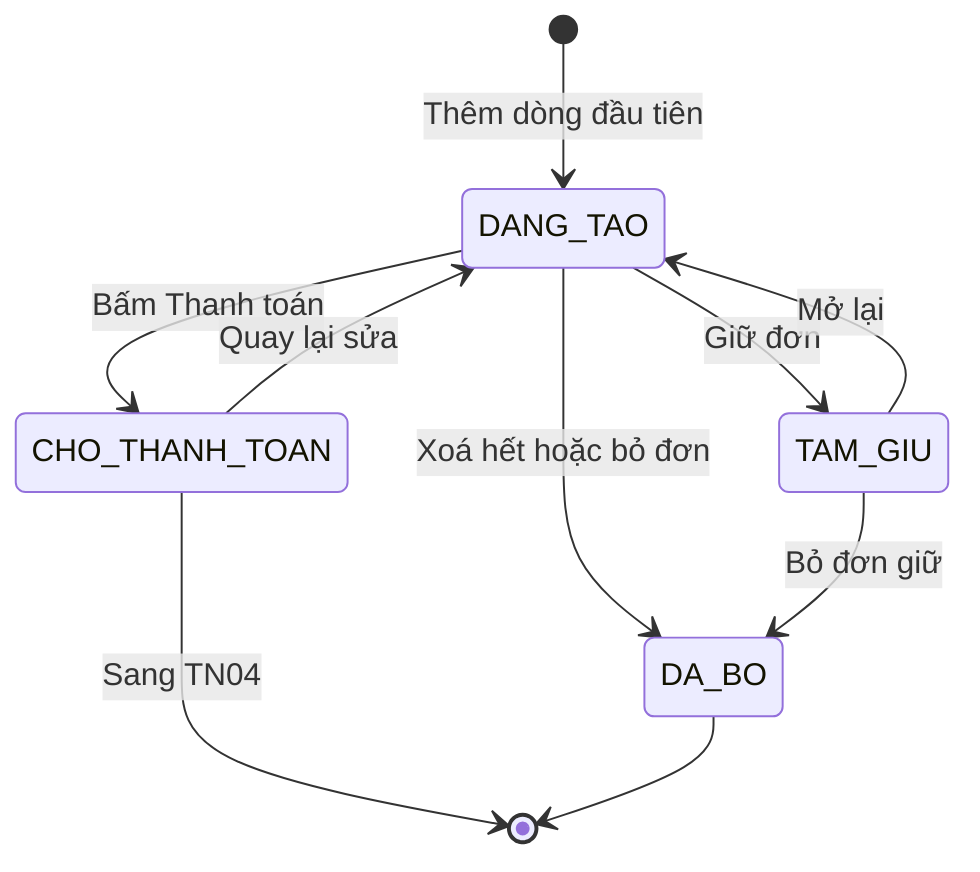
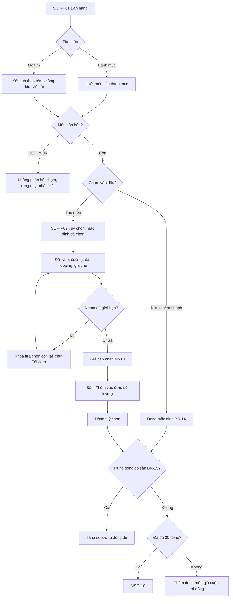
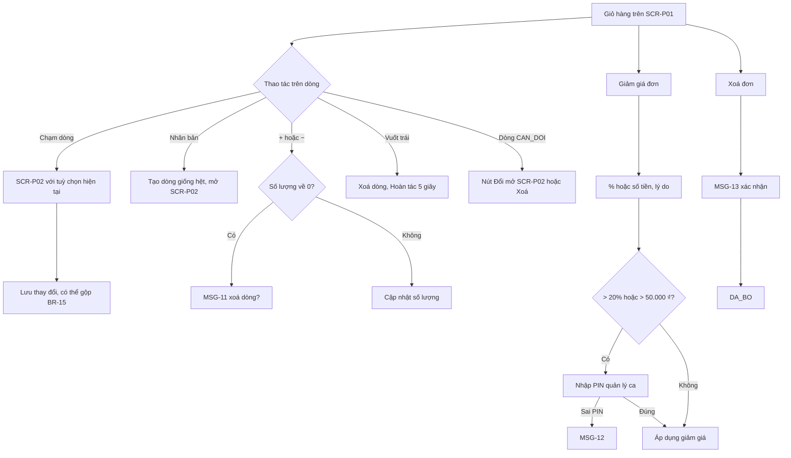
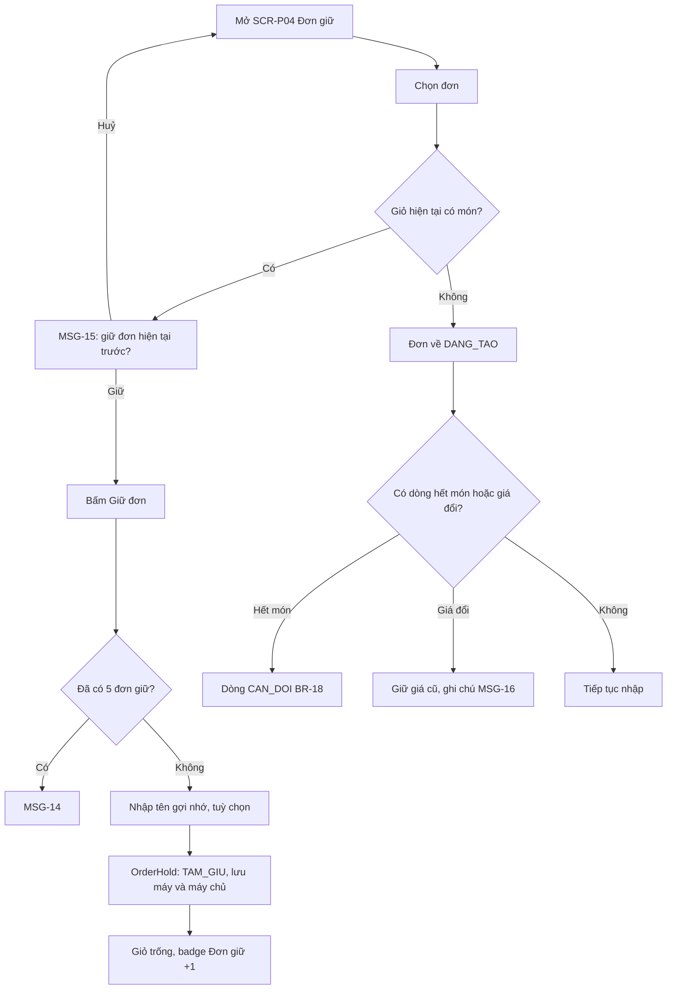
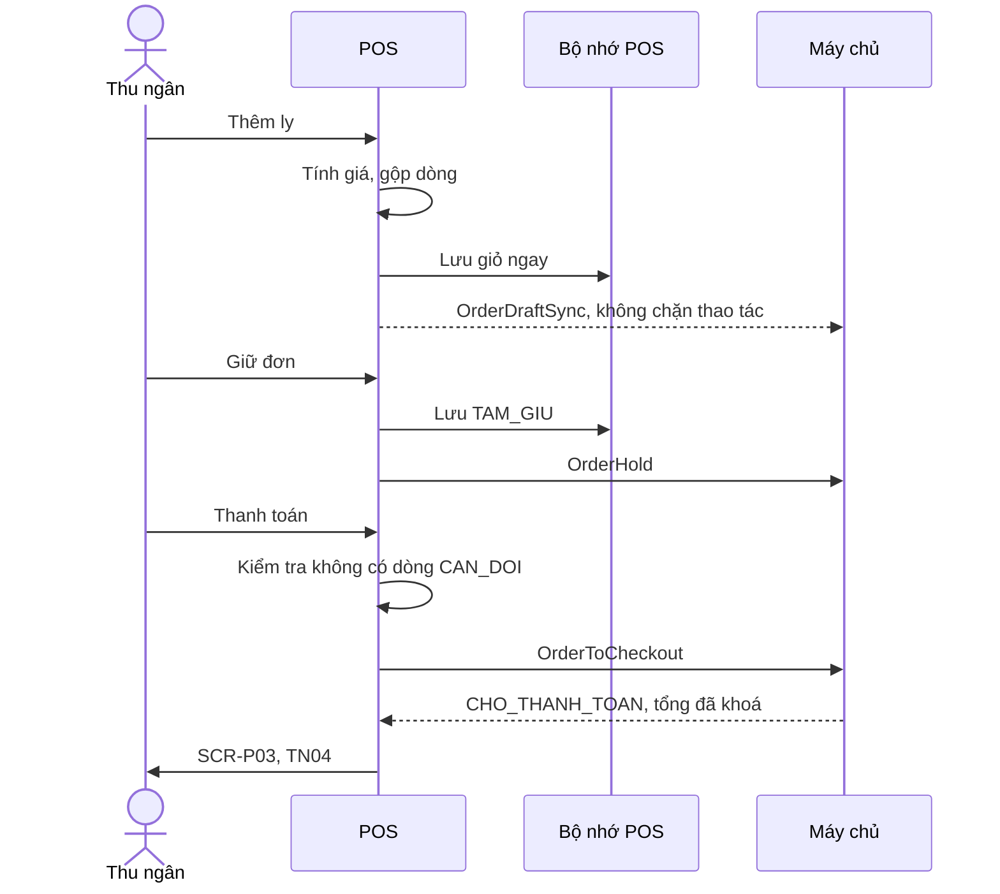

> **Mã:** DE06-TN02-SRS · **Trạng thái:** nháp · **Người viết:** Design (mock) · **PRD:** [PRD.md](PRD.md)

# UC-DE06-02 - Tạo đơn tại quầy

> **Bản mock.** Giá trị `[giả định]` cần BA xác nhận. SRS này mô tả đơn từ `DANG_TAO` tới `CHO_THANH_TOAN`, kèm `TAM_GIU` và `DA_BO`; thanh toán xem [SRS TN04](../TN04-thanh-toan-in-bill/SRS.md).

## 1. Tổng quan

| **Mục** | **Nội dung** |
| --- | --- |
| Mục tiêu | Thu ngân nhập đơn nhanh, đúng tuỳ chọn; sửa giỏ; giữ đơn; chuyển sang thanh toán |
| Actor | Thu ngân · Quản lý ca (PIN giảm giá) · POS · Máy chủ |
| Phạm vi | Màn bán hàng, tìm món, thêm nhanh, màn tuỳ chọn, giỏ hàng, giảm giá đơn, giữ đơn, hình thức, sang thanh toán |
| Ngoài phạm vi | Khách tự đặt, tích điểm, mã khuyến mãi, chia gộp đơn, giao hàng |
| Nền tảng | POS (tablet ngang) `[giả định]` |
| Figma | `[chưa có]` |

## 2. User Story

| **ID** | **As a** | **I want** | **So that** |
| --- | --- | --- | --- |
| US-06 | Thu ngân | Thêm ly mặc định bằng một chạm | Phục vụ nhanh |
| US-07 | Thu ngân | Chọn tuỳ chọn với mặc định sẵn | Ít chạm, ít sai |
| US-08 | Thu ngân | Nhân bản, sửa dòng giỏ | Nhập nhóm ly giống nhau nhanh |
| US-09 | Thu ngân | Giữ đơn của khách chưa quyết định | Không chắn hàng |
| US-10 | Thu ngân | Đọc lại đơn nhanh cho khách | Xác nhận đúng trước khi thu tiền |

## 3. Business Rules

| **Mã** | **Quy tắc** |
| --- | --- |
| BR-11 | **Đăng nhập POS** bằng PIN 4 số của nhân viên; phiên POS gắn với ca đang mở (TN05). Chưa mở ca → không tạo đơn được (MSG-09) |
| BR-12 | **Dòng đơn** gồm: món, size, các tuỳ chọn (lựa chọn và số phần), ghi chú, số lượng, đơn giá, bản chụp tên và giá theo menu_version lúc thêm (BR-09) |
| BR-13 | **Đơn giá dòng** = giá size + tổng (giá cộng thêm × số phần) của các lựa chọn. **Thành tiền** = đơn giá × số lượng |
| BR-14 | **Thêm nhanh** = size đầu tiên + mặc định của mọi nhóm; không mở màn tuỳ chọn |
| BR-15 | **Gộp dòng**: thêm ly có cùng món, size, tuỳ chọn, ghi chú với dòng có sẵn → tăng số lượng dòng đó thay vì thêm dòng mới |
| BR-16 | **Giới hạn**: số lượng mỗi dòng 1–20; tối đa 30 dòng mỗi đơn; ghi chú ≤ 50 ký tự `[giả định]` |
| BR-17 | **Hiển thị dòng giỏ**: dòng phụ chỉ ghi lựa chọn khác mặc định và ghi chú, chữ đậm |
| BR-18 | **Món hết trong giỏ**: khi món hoặc lựa chọn chuyển `HET_MON`/`HET` (TN01), dòng chứa nó có cờ `CAN_DOI`; còn dòng `CAN_DOI` thì nút Thanh toán disabled |
| BR-19 | **Giảm giá đơn**: % (1–100) hoặc số tiền (≤ tạm tính); bắt buộc lý do; > 20% hoặc > 50.000 ₫ cần PIN quản lý ca `[giả định]` |
| BR-20 | **Giữ đơn**: tối đa 5 đơn `TAM_GIU` mỗi máy; tên gợi nhớ ≤ 20 ký tự; đơn giữ được lưu trên máy và máy chủ; chốt ca còn đơn giữ → phải xử lý (TN05) |
| BR-21 | **Hình thức** `MANG_DI` (mặc định) hoặc `TAI_QUAN`; in trên bill và tem ly |
| BR-22 | **Sang thanh toán**: giỏ có ≥ 1 dòng, không có dòng `CAN_DOI` → đơn `CHO_THANH_TOAN`; giá các dòng bị khoá. Quay lại sửa → `DANG_TAO` |

## 4. Trạng thái

### 4.1 Trạng thái đơn trong phạm vi SRS này

### 4.2 Trạng thái dòng giỏ

| **Trạng thái** | **Điều kiện** | **Hiển thị** |
| --- | --- | --- |
| `HOP_LE` | Món, lựa chọn đều đang bán | Bình thường |
| `CAN_DOI` | Món hoặc lựa chọn vừa hết (BR-18) | Viền đỏ, MSG-07, nút "Đổi" |

## 5. Use Case

### UC-05 Thêm món vào đơn

| **Mục** | **Nội dung** |
| --- | --- |
| Tiền điều kiện | Thu ngân đăng nhập POS, ca đang mở |
| Hậu điều kiện | Dòng được thêm hoặc gộp vào giỏ; tổng cập nhật |

**Luồng chính**

| **Bước** | **Actor** | **Mô tả** |
| --- | --- | --- |
| 1 | Thu ngân | Chọn danh mục hoặc gõ tìm ở **SCR-P01** |
| 2 | Thu ngân | Chạm thẻ món |
| 3 | POS | Mở **SCR-P02** với size và lựa chọn mặc định |
| 4 | Thu ngân | Đổi tuỳ chọn theo yêu cầu của khách; chọn số lượng |
| 5 | POS | Cập nhật giá ly theo BR-13 |
| 6 | Thu ngân | Bấm "Thêm vào đơn" |
| 7 | POS | Thêm hoặc gộp dòng (BR-15); đóng **SCR-P02**; cập nhật tổng |

**Luồng thay thế**

| **Mã** | **Điều kiện** | **Xử lý** |
| --- | --- | --- |
| A1 | Bấm "+" trên thẻ | Thêm nhanh theo BR-14, không mở **SCR-P02**; hiệu ứng ly bay vào giỏ |
| A2 | Lựa chọn đang `HET` | Mờ, không chọn được; nếu là mặc định thì để trống và buộc chọn khác (nhóm `CHON_MOT`) |
| A3 | Đóng **SCR-P02** không thêm | Không thay đổi giỏ |
| A4 | Ghi chú mẫu | Chạm chip ghi chú, có thể chọn nhiều, tổng ≤ 50 ký tự |

**Luồng lỗi**

| **Mã** | **Điều kiện** | **Xử lý** |
| --- | --- | --- |
| E1 | Chưa mở ca | MSG-09 |
| E2 | Đủ 30 dòng | MSG-10 |
| E3 | Số lượng > 20 | Nút + disabled ở 20 |

### UC-06 Sửa giỏ hàng và giảm giá

| **Mục** | **Nội dung** |
| --- | --- |
| Tiền điều kiện | Đơn `DANG_TAO` có ≥ 1 dòng |
| Hậu điều kiện | Giỏ cập nhật; tổng tính lại |

### UC-07 Giữ đơn và mở lại

| **Mục** | **Nội dung** |
| --- | --- |
| Tiền điều kiện | Đơn `DANG_TAO` có ≥ 1 dòng |
| Hậu điều kiện | Đơn `TAM_GIU`; giỏ trống cho đơn mới |

### UC-08 Sang thanh toán

| **Bước** | **Actor** | **Mô tả** |
| --- | --- | --- |
| 1 | Thu ngân | Chọn hình thức `MANG_DI` hoặc `TAI_QUAN` (BR-21) |
| 2 | Thu ngân | Bấm "Thanh toán {tổng}" |
| 3 | POS | Kiểm tra BR-22; hợp lệ → đơn `CHO_THANH_TOAN`, mở **SCR-P03** (SRS TN04) |

## 6. Điểm vào

| **Điểm vào** | **Dẫn tới** | **Ghi chú** |
| --- | --- | --- |
| Đăng nhập PIN trên POS | **SCR-P01** | Ca phải đang mở |
| Chạm thẻ món, nút "+" | UC-05 | |
| Chạm dòng giỏ | UC-06 | |
| Badge "Đơn giữ" ở **SCR-P01** | UC-07, **SCR-P04** | |
| "Quay lại sửa" ở **SCR-P03** | Đơn về `DANG_TAO` | SRS TN04 |

## 7. Mô tả màn hình

### SCR-P01 Bán hàng (POS, ngang)

| **#** | **Thành phần** | **Loại** | **Hành vi** |
| --- | --- | --- | --- |
| 1 | Thanh trên | Header | Tên nhân viên, ca, trạng thái mạng, badge Đơn giữ, nút Đơn trong ca |
| 2 | Danh mục | Cột trái | "Bán chạy" đầu tiên, rồi các danh mục; chạm lọc lưới |
| 3 | Tìm món | Search | Không dấu, viết tắt chữ đầu |
| 4 | Lưới món | Grid | Thẻ ≥ 120 × 100 px: ảnh nhỏ, tên, giá từ; nút "+"; trạng thái Hết |
| 5 | Giỏ hàng | Cột phải cố định | Dòng: tên, size, số lượng, thành tiền; dòng phụ BR-17; nút nhân bản, +, −; vuốt trái xoá |
| 6 | Tạm tính, giảm giá, tổng | Footer giỏ | Giảm giá chạm để sửa |
| 7 | Hình thức | Segmented | Mang đi · Tại quán |
| 8 | Giữ đơn · Xoá đơn | Buttons | |
| 9 | Thanh toán {tổng} | Button lớn | Disabled khi giỏ trống hoặc có `CAN_DOI` |

### SCR-P02 Tuỳ chọn món (POS, lớp phủ)

| **#** | **Thành phần** | **Loại** | **Hành vi** |
| --- | --- | --- | --- |
| 1 | Tên món, giá ly | Header | Giá cập nhật theo BR-13 |
| 2 | Size | Segmented lớn | 1–3 size, kèm giá |
| 3 | Mức đường, Mức đá | Segmented lớn | Mặc định đã chọn, chữ đậm khi khác mặc định |
| 4 | Topping | Chip có bộ đếm | Chạm tăng phần (tối đa theo BR-04); giữ lâu bỏ; "Tối đa {n}" khi đủ |
| 5 | Ghi chú | Chips mẫu + ô nhập | ≤ 50 ký tự |
| 6 | Số lượng | Stepper | 1–20 |
| 7 | Thêm vào đơn · {giá} | Button lớn | Hoặc "Lưu" khi sửa dòng |

### SCR-P04 Đơn đã giữ, đơn trong ca (POS)

| **#** | **Thành phần** | **Loại** | **Hành vi** |
| --- | --- | --- | --- |
| 1 | Tab | Tabs | Đơn giữ · Đơn trong ca |
| 2 | Thẻ đơn giữ | Card | Tên gợi nhớ, số ly, tổng, "Giữ {n} phút"; Mở, Bỏ |
| 3 | Đơn trong ca | Table | Số thứ tự, giờ, tổng, phương thức, trạng thái; mở chi tiết, in lại, huỷ (SRS TN04) |

## 8. API

| **API** | **Request chính** | **Response chính** | **Timeout / retry** `[giả định]` |
| --- | --- | --- | --- |
| \[PosLogin\] | device_id, pin | staff, role, shift_id | 3s / 1 lần |
| \[ItemSearch\] (trên máy) | keyword | Món khớp | Chạy trên menu đã lưu |
| \[OrderDraftSync\] | order_id, lines, discount, mode, status | saved_at | 3s / tự đồng bộ lại; giỏ luôn lưu trên máy trước |
| \[OrderHold\] | order_id, name | status `TAM_GIU` | 3s / 2 lần |
| \[OrderHeldList\] | device_id | Đơn giữ | 3s / 1 lần |
| \[ManagerPinVerify\] | pin, action | approved, manager_id | 3s / 1 lần |
| \[OrderToCheckout\] | order_id | status `CHO_THANH_TOAN`, tổng đã khoá | 3s / 2 lần |

Tính giá, gộp dòng, tìm món chạy trên POS với menu đã lưu, để không phụ thuộc mạng khi nhập đơn.

## 9. Danh sách thông báo

| **ID** | **Nơi hiện** | **Nội dung (VI)** |
| --- | --- | --- |
| MSG-09 | Popup | Chưa mở ca. Vui lòng mở ca để bắt đầu bán hàng. \[Mở ca\] |
| MSG-10 | Toast | Mỗi đơn tối đa 30 dòng. Vui lòng tách thành đơn khác |
| MSG-11 | Popup | Xoá "{món}" khỏi đơn? \[Huỷ\] \[Xoá\] |
| MSG-12 | Inline | PIN không đúng hoặc không có quyền duyệt giảm giá |
| MSG-13 | Popup | Xoá toàn bộ đơn đang nhập? \[Huỷ\] \[Xoá đơn\] |
| MSG-14 | Toast | Đã giữ 5 đơn. Vui lòng xử lý bớt đơn giữ |
| MSG-15 | Popup | Giỏ hiện tại đang có món. Giữ đơn này trước khi mở đơn khác? \[Giữ đơn hiện tại\] \[Huỷ\] |
| MSG-16 | Inline giỏ | Giá menu đã thay đổi. Đơn giữ áp dụng giá lúc giữ |

MSG-07 dùng lại từ SRS TN01. Bản EN: `[chờ bổ sung]`.

## 10. Yêu cầu phi chức năng

| **Mục** | **Yêu cầu** `[giả định]` |
| --- | --- |
| Hiệu năng | Phản hồi chạm ≤ 100 ms; mở **SCR-P02** ≤ 200 ms; tìm món ≤ 100 ms |
| Offline | Nhập đơn, giữ đơn chạy được khi mất mạng; đồng bộ khi có mạng |
| Độ bền | Giỏ hàng không mất khi app bị tắt, máy khởi động lại |
| Công thái học | Vùng chạm ≥ 48 px; nút chính ở tầm tay phải; chữ giá ≥ 18 px |
| Tracking | Thời gian nhập đơn, số chạm mỗi ly, thêm nhanh, sửa dòng, nhân bản, giảm giá (mức, lý do, có PIN), giữ đơn, bỏ đơn |
| Accessibility | Trạng thái Hết có chữ, không chỉ mờ; tuỳ chọn khác mặc định in đậm kèm dấu "•" |
