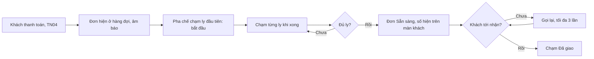

> **Mã:** DE06-TN03-PRD · **Trạng thái:** nháp · **Người viết:** Design (mock) · **SRS:** [SRS.md](SRS.md)

# PRD Màn pha chế realtime (Quản lý đơn hàng quán trà sữa)

> **Bản mock.** Con số đánh dấu `[giả định]` dùng để dựng flow, cần PO xác nhận trước khi dùng.

## 1. Bối cảnh và vấn đề

### 1.1 Bối cảnh

Sau khi khách thanh toán ([TN04](../TN04-thanh-toan-in-bill/PRD.md)), đơn phải tới quầy pha chế ngay. Pha chế đứng cách màn hình một khoảng, tay ướt, làm nhiều ly cùng lúc. Họ cần thấy ly nào làm trước, ly đó có gì khác chuẩn, và báo cho khách khi xong.

### 1.2 Vấn đề

| **Vấn đề** | **Hệ quả** |
| --- | --- |
| Phiếu giấy dễ thất lạc, khó đọc | Làm thiếu ly, sai tuỳ chọn |
| Không biết đơn nào chờ lâu nhất | Khách đến trước nhận sau |
| Đơn nhiều ly, làm xong ly nào không rõ | Quên ly, giao thiếu |
| Gọi khách bằng miệng giờ cao điểm | Khách không nghe, đứng chắn quầy |
| Đơn bị huỷ mà pha chế không biết | Pha thừa, tốn nguyên liệu |

### 1.3 Mục tiêu

- Đơn hiện trên màn pha chế ≤ 3 giây sau khi thanh toán `[giả định]`.
- Thời gian từ thanh toán tới sẵn sàng trung vị ≤ 5 phút giờ cao điểm `[giả định]`.
- Tỉ lệ giao thiếu ly ≈ 0.

## 2. Người dùng

| **Nhóm** | **Nhu cầu với tính năng này** |
| --- | --- |
| Pha chế | Đọc rõ từ xa, chạm bằng tay ướt, ít thao tác |
| Thu ngân | Biết đơn của khách đang ở đâu khi khách hỏi |
| Khách | Biết khi nào tới lượt, được gọi số rõ ràng |

## 3. Phạm vi

### 3.1 Trong phạm vi (MVP)

- Hàng đợi pha chế: đơn sắp theo thời gian thanh toán, thẻ theo đơn, ly theo dòng.
- Đánh dấu từng ly xong; đơn xong khi đủ ly.
- Hiện rõ tuỳ chọn khác chuẩn, ghi chú, hình thức Tại quán hoặc Mang đi.
- Đơn chờ lâu đổi màu theo ngưỡng thời gian.
- Gọi khách: màn hình số thứ tự cho khách, âm báo, gọi lại.
- Xác nhận khách đã nhận.
- Đơn bị huỷ: báo rõ trên màn, gỡ khỏi hàng đợi.
- In tem ly (từ TN04) dùng chung số thứ tự.

### 3.2 Ngoài phạm vi

- Chia việc cho nhiều pha chế, nhiều trạm (trà, cà phê) → phase sau.
- Hướng dẫn công thức từng bước trên màn.
- Ưu tiên đơn thủ công (VIP).
- Gọi khách qua tin nhắn.

## 4. Nguyên tắc sản phẩm

### 4.1 Đọc được từ một sải tay

Chữ lớn, tương phản cao. Tuỳ chọn khác chuẩn nổi bật, tuỳ chọn mặc định không cần in.

### 4.2 Đến trước làm trước

Hàng đợi luôn sắp theo thời gian thanh toán. Đơn chờ lâu đổi màu để không bị bỏ quên.

### 4.3 Một chạm cho một ly

Chạm ly để đánh dấu xong; chạm lại để bỏ đánh dấu. Không có menu, không có popup.

### 4.4 Khách biết lượt của mình

Số thứ tự hiện trên màn hình khách, kèm âm báo khi sẵn sàng.

## 5. Quy tắc nghiệp vụ

| **Quy tắc** | **Giá trị** `[giả định]` |
| --- | --- |
| Vào hàng đợi | Khi đơn `DA_THANH_TOAN` |
| Thứ tự | Theo thời điểm thanh toán, cũ trước |
| Ngưỡng màu | Bình thường < 5 phút; Chú ý 5–10 phút; Trễ > 10 phút |
| Đơn xong | Mọi ly được đánh dấu xong |
| Gọi khách | Số hiện trên màn khách tới khi khách nhận; gọi lại tối đa 3 lần |
| Tự xác nhận nhận | Sau 15 phút ở Sẵn sàng tự chuyển Đã giao |
| Hoàn tác | Bỏ đánh dấu ly được trong lúc đơn chưa Đã giao |

- Các giá trị trên là **cấu hình theo quán**, không cố định trong code.

## 6. Luồng trải nghiệm

| **Bước** | **Giai đoạn** | **Trải nghiệm pha chế** | **Trải nghiệm khách** |
| --- | --- | --- | --- |
| 1 | Đơn mới | Thẻ đơn xuất hiện cuối hàng đợi, âm "ting" | Cầm bill có số thứ tự |
| 2 | Pha chế | Chạm ly khi làm xong; thẻ đổi màu theo thời gian chờ | Màn khách: "Đang pha chế: {số}" |
| 3 | Sẵn sàng | Đơn xong chuyển lên hàng Sẵn sàng | Màn khách: "Mời nhận: {số}", âm báo |
| 4 | Giao | Chạm "Đã giao" khi khách nhận | Nhận ly |

## 7. Use Cases, User Stories và Acceptance Criteria

### UC1. Nhận và làm đơn

#### US1.1 Thấy đơn mới ngay

User Story: Là pha chế, tôi muốn thấy đơn ngay khi khách trả tiền để bắt đầu làm luôn.

AC01: Đơn mới xuất hiện ≤ 3 giây sau thanh toán, có âm báo (tắt được).

AC02: Thẻ đơn có số thứ tự to, giờ thanh toán, thời gian chờ, Tại quán hoặc Mang đi, số ly.

AC03: Mỗi ly ghi tên món, size; tuỳ chọn khác chuẩn và ghi chú in đậm, nổi màu.

AC04: Mất kết nối → báo đỏ trên màn; có kết nối lại thì tải đủ đơn còn thiếu.

#### US1.2 Đánh dấu ly xong

User Story: Là pha chế, tôi muốn đánh dấu từng ly bằng một chạm để không quên ly.

AC01: Chạm ly → gạch ngang, dấu tích; chạm lại để bỏ.

AC02: Chạm ly đầu tiên → đơn chuyển "Đang pha chế".

AC03: Đủ ly → đơn chuyển Sẵn sàng tự động, chuyển lên hàng Sẵn sàng.

AC04: Nút "Xong cả đơn" cho đơn nhiều ly.

#### US1.3 Không bỏ quên đơn

User Story: Là pha chế, tôi muốn thấy rõ đơn chờ lâu để không bỏ quên khách.

AC01: Thẻ đổi màu ở 5 phút và 10 phút, kèm biểu tượng và chữ.

AC02: Đơn trễ > 10 phút luôn được ghim lên đầu hàng đợi.

### UC2. Gọi khách và giao

#### US2.1 Gọi khách

User Story: Là pha chế, tôi muốn gọi khách khi đơn sẵn sàng để khách nhận ly đúng lúc.

AC01: Đơn Sẵn sàng → số hiện trên màn hình khách, kèm âm báo.

AC02: Nút "Gọi lại" phát âm báo và nhấp nháy số; tối đa 3 lần.

AC03: Chạm "Đã giao" → đơn rời màn và màn khách.

AC04: Sau 15 phút không chạm → tự chuyển Đã giao.

### UC3. Đơn bị huỷ

AC01: Đơn bị huỷ (TN04) → thẻ hiện nhãn "ĐÃ HUỶ" trong 30 giây rồi tự gỡ; có âm báo khác.

AC02: Đơn đã có ly làm xong mà bị huỷ → báo rõ số ly đã làm để chủ quán xử lý.

## 8. Chỉ số theo dõi `[giả định]`

| **Chỉ số** | **Định nghĩa** | **Mục tiêu MVP** |
| --- | --- | --- |
| Độ trễ hiện đơn | Từ thanh toán tới hiện trên màn pha chế | ≤ 3 giây (p95) |
| Thời gian pha chế | Từ thanh toán tới Sẵn sàng | ≤ 5 phút giờ cao điểm (trung vị) |
| Tỉ lệ đơn trễ | Đơn > 10 phút / tổng đơn | ≤ 10% |
| Thời gian chờ nhận | Từ Sẵn sàng tới Đã giao | Theo dõi |
| Tỉ lệ tự xác nhận | Đơn tự chuyển Đã giao / tổng đơn | Theo dõi; cao là dấu hiệu pha chế không bấm |
| Ly làm thừa do huỷ | Ly đã làm trong đơn bị huỷ | Theo dõi |

## 9. Phụ thuộc và rủi ro

| **Mục** | **Mô tả** | **Hướng xử lý** |
| --- | --- | --- |
| Mạng nội bộ quán | Màn pha chế mất kết nối | Báo đỏ; tem ly in ở POS làm dự phòng |
| Màn cảm ứng với tay ướt | Chạm không ăn hoặc ăn nhầm | Vùng chạm lớn; bỏ đánh dấu dễ dàng |
| Ồn giờ cao điểm | Không nghe âm báo | Màn khách nhấp nháy; âm lượng chỉnh được |
| Nhiều đơn cùng lúc | Màn tràn | Thẻ gọn, cuộn ngang; ghim đơn trễ |

## 10. Câu hỏi mở

> Câu nào đã có giá trị ở mục 5 thì giá trị đó là **tạm chốt** `[giả định]` để dựng flow. Câu hỏi vẫn để mở cho đến khi PO xác nhận.

- Đơn có vào màn pha chế trước khi thanh toán không (khách quen trả sau)?
- Có cần chia trạm pha chế ngay ở MVP?
- Màn khách dùng TV riêng hay mặt sau của POS? → **Đã chốt:** Tablet riêng.
- Tự xác nhận nhận sau 15 phút có hợp lý không?
