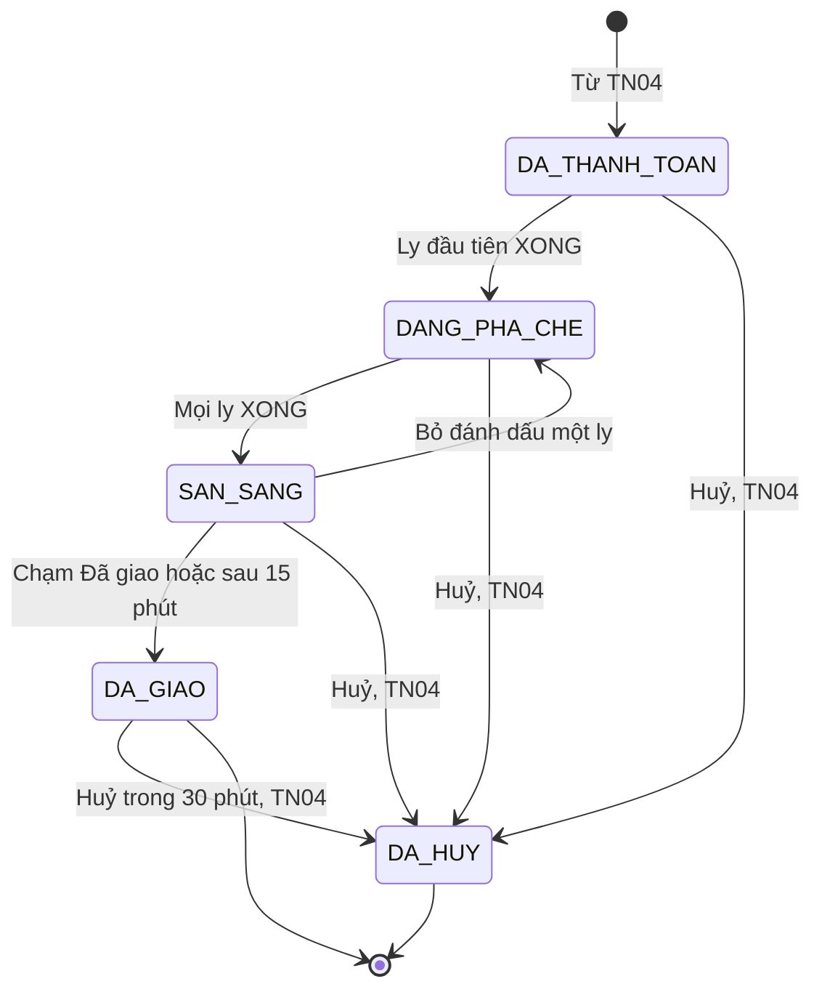
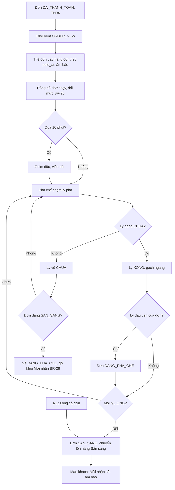
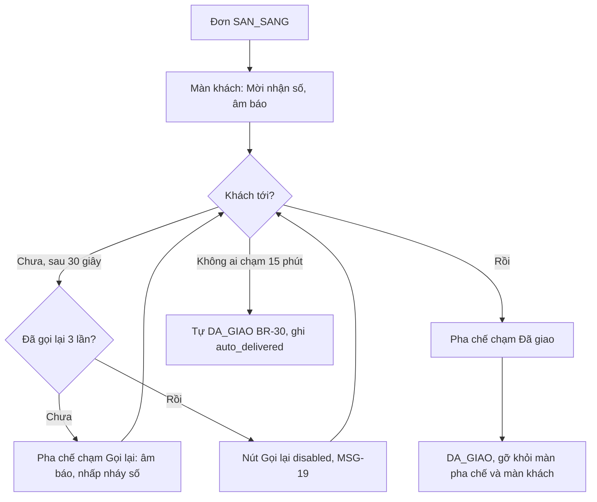
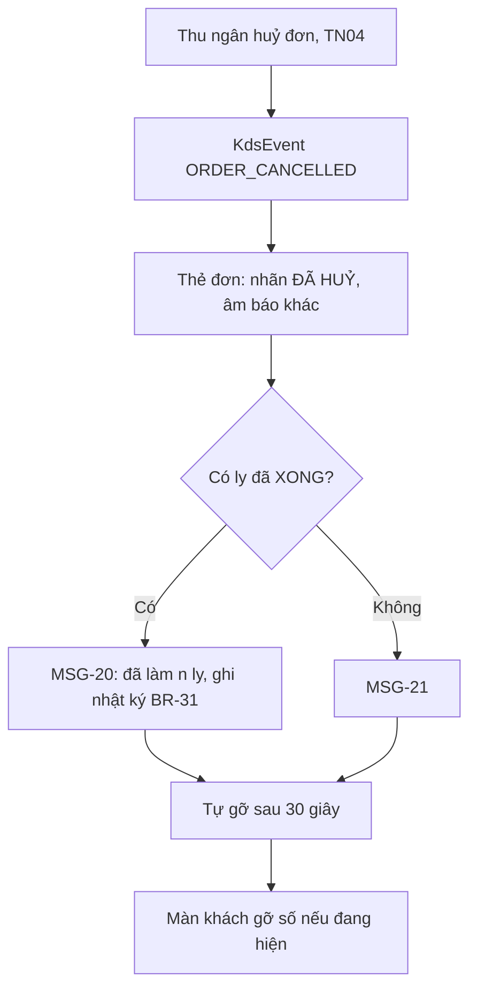
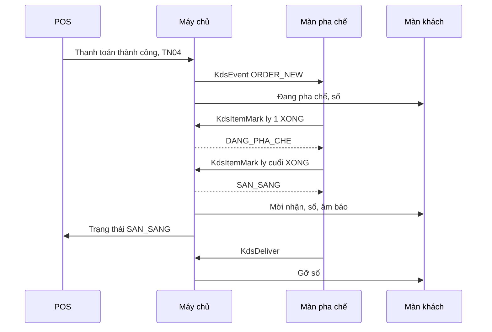

> **Mã:** DE06-TN03-SRS · **Trạng thái:** nháp · **Người viết:** Design (mock) · **PRD:** [PRD.md](PRD.md)

# UC-DE06-03 - Màn pha chế realtime

> **Bản mock.** Giá trị `[giả định]` cần BA xác nhận. SRS này mô tả đơn từ `DA_THANH_TOAN` tới `DA_GIAO`; thanh toán và huỷ xem [SRS TN04](../TN04-thanh-toan-in-bill/SRS.md).

## 1. Tổng quan

| **Mục** | **Nội dung** |
| --- | --- |
| Mục tiêu | Pha chế nhận đơn realtime, làm theo thứ tự, đánh dấu từng ly, gọi khách và xác nhận giao |
| Actor | Pha chế · Màn pha chế · Màn khách · POS · Máy chủ |
| Phạm vi | Hàng đợi, thẻ đơn, đánh dấu ly, ngưỡng trễ, Sẵn sàng, gọi khách, Đã giao, đơn bị huỷ, mất kết nối |
| Ngoài phạm vi | Nhiều trạm, hướng dẫn công thức, ưu tiên thủ công, gọi qua tin nhắn |
| Nền tảng | Màn pha chế (tablet dọc hoặc ngang), Màn khách (TV hoặc tablet) `[giả định]` |
| Figma | `[chưa có]` |

## 2. User Story

| **ID** | **As a** | **I want** | **So that** |
| --- | --- | --- | --- |
| US-11 | Pha chế | Thấy đơn ngay khi khách trả tiền | Bắt đầu làm luôn |
| US-12 | Pha chế | Đọc rõ tuỳ chọn khác chuẩn | Pha đúng |
| US-13 | Pha chế | Đánh dấu từng ly bằng một chạm | Không quên ly |
| US-14 | Pha chế | Thấy đơn chờ lâu | Không bỏ quên khách |
| US-15 | Khách | Thấy số của mình khi sẵn sàng | Nhận ly đúng lúc |

## 3. Business Rules

| **Mã** | **Quy tắc** |
| --- | --- |
| BR-23 | **Vào hàng đợi**: đơn `DA_THANH_TOAN` được đẩy tới màn pha chế qua kết nối realtime; mỗi ly là một "ly pha" (dòng số lượng 3 → 3 ly pha) |
| BR-24 | **Thứ tự**: sắp theo `paid_at` tăng dần; đơn `TRE` luôn được ghim đầu hàng đợi, giữa các đơn trễ vẫn theo `paid_at` |
| BR-25 | **Ngưỡng thời gian chờ** tính từ `paid_at`: `BINH_THUONG` < 5 phút, `CHU_Y` 5–10 phút, `TRE` > 10 phút `[giả định]` |
| BR-26 | **Hiển thị ly pha**: tên món, size; chỉ in tuỳ chọn khác mặc định và ghi chú (in đậm, có dấu "•"); topping ghi số phần khi > 1 |
| BR-27 | **Đánh dấu**: chạm ly pha → `XONG`; chạm lại → `CHUA`. Ly đầu tiên `XONG` → đơn `DANG_PHA_CHE`. Mọi ly `XONG` → đơn `SAN_SANG` |
| BR-28 | **Bỏ đánh dấu** ở đơn `SAN_SANG` → đơn về `DANG_PHA_CHE`, gỡ số khỏi màn khách |
| BR-29 | **Gọi khách**: đơn `SAN_SANG` hiện số trên màn khách kèm âm báo; "Gọi lại" tối đa 3 lần, mỗi lần cách ≥ 30 giây |
| BR-30 | **Đã giao**: pha chế chạm "Đã giao", hoặc tự chuyển sau 15 phút ở `SAN_SANG` `[giả định]` |
| BR-31 | **Đơn bị huỷ** khi đang ở màn pha chế: thẻ hiện nhãn "ĐÃ HUỶ", âm báo khác, tự gỡ sau 30 giây; ghi số ly đã `XONG` vào nhật ký huỷ (TN05 dùng để ghi hao hụt) |
| BR-32 | **Mất kết nối**: màn pha chế báo đỏ; khi kết nối lại gọi \[KdsSync\] lấy đầy đủ đơn chưa `DA_GIAO`; thao tác đánh dấu khi mất mạng được xếp hàng và gửi lại |

## 4. Trạng thái

### 4.1 Trạng thái đơn trong phạm vi SRS này

### 4.2 Thẻ đơn theo thời gian chờ

| **Mức** | **Điều kiện** | **Hiển thị** |
| --- | --- | --- |
| `BINH_THUONG` | < 5 phút | Viền xám, đồng hồ "{m}:{ss}" |
| `CHU_Y` | 5–10 phút | Viền vàng, biểu tượng đồng hồ, chữ "Chờ lâu" |
| `TRE` | > 10 phút | Viền đỏ đậm, biểu tượng cảnh báo, chữ "Trễ", ghim đầu |

### 4.3 Màn khách thấy gì

| **Trạng thái đơn** | **Màn khách** |
| --- | --- |
| `DA_THANH_TOAN`, `DANG_PHA_CHE` | Cột "Đang pha chế": số thứ tự |
| `SAN_SANG` | Cột "Mời nhận": số thứ tự cỡ lớn, nhấp nháy khi gọi |
| `DA_GIAO`, `DA_HUY` | Không hiện |

## 5. Use Case

### UC-09 Nhận đơn và pha chế

| **Mục** | **Nội dung** |
| --- | --- |
| Tiền điều kiện | Màn pha chế đăng nhập, ca đang mở |
| Hậu điều kiện thành công | Đơn `SAN_SANG`; số hiện trên màn khách |
| Hậu điều kiện thất bại | Đơn ở `DANG_PHA_CHE`; vẫn hiện trên hàng đợi |

**Luồng chính**

| **Bước** | **Actor** | **Mô tả** |
| --- | --- | --- |
| 1 | Máy chủ | Đẩy \[KdsEvent\] `ORDER_NEW` khi đơn `DA_THANH_TOAN` |
| 2 | Màn pha chế | Thêm thẻ đơn theo BR-24, phát âm báo |
| 3 | Pha chế | Đọc ly pha (BR-26), làm ly |
| 4 | Pha chế | Chạm ly pha khi xong |
| 5 | Màn pha chế | Ly `XONG`; gửi \[KdsItemMark\]; cập nhật trạng thái đơn (BR-27) |
| 6 | Máy chủ | Đơn `SAN_SANG` → đẩy cho màn khách và POS |

**Luồng thay thế**

| **Mã** | **Điều kiện** | **Xử lý** |
| --- | --- | --- |
| A1 | Chạm nhầm | Chạm lại để bỏ (BR-27, BR-28) |
| A2 | "Xong cả đơn" | Mọi ly `XONG` một lần |
| A3 | Đơn nhiều hơn chỗ trên màn | Cuộn ngang; số đơn bị ẩn hiện ở cạnh màn |
| A4 | Thu ngân hỏi đơn của khách | POS **SCR-P04** hiện trạng thái đơn theo cùng dữ liệu |

**Luồng lỗi**

| **Mã** | **Điều kiện** | **Xử lý** |
| --- | --- | --- |
| E1 | Mất kết nối | MSG-17 thanh đỏ; đánh dấu xếp hàng gửi lại; có mạng lại → \[KdsSync\] (BR-32) |
| E2 | Đánh dấu bị máy chủ từ chối (đơn đã huỷ) | Hiện "ĐÃ HUỶ" (UC-11) |

### UC-10 Gọi khách và giao

| **Mục** | **Nội dung** |
| --- | --- |
| Tiền điều kiện | Đơn `SAN_SANG` |
| Hậu điều kiện | Đơn `DA_GIAO` |

**Luồng thay thế**

| **Mã** | **Điều kiện** | **Xử lý** |
| --- | --- | --- |
| A1 | Khách báo ly sai khi đơn còn `SAN_SANG`, quán làm lại | Pha chế bỏ đánh dấu ly đó (BR-28): đơn về `DANG_PHA_CHE`, gỡ số khỏi màn khách; làm lại rồi đánh dấu `XONG`. Nguyên liệu của ly hỏng ghi hao hụt ở SRS TN05 `[giả định]` |
| A2 | Khách báo ly sai sau khi đơn `DA_GIAO` | Trong 30 phút: thu ngân huỷ đơn và hoàn tiền theo SRS TN04 (lý do "Làm sai món"), rồi tạo đơn mới nếu khách muốn làm lại. Quá 30 phút: quản lý ca xử lý ngoài hệ thống `[giả định]` |
| A3 | Khách không tới nhận | Đơn tự `DA_GIAO` sau 15 phút (BR-30) với cờ `auto_delivered`; ly để ở quầy, không hoàn tiền |

### UC-11 Đơn bị huỷ trên màn pha chế

| **Mục** | **Nội dung** |
| --- | --- |
| Tiền điều kiện | Đơn đang ở hàng đợi bị huỷ (TN04) |
| Hậu điều kiện | Thẻ gỡ khỏi màn; số ly đã làm được ghi |

## 6. Điểm vào

| **Điểm vào** | **Dẫn tới** | **Ghi chú** |
| --- | --- | --- |
| Đăng nhập PIN trên màn pha chế | **SCR-K01** | Vai trò pha chế, quản lý ca, chủ quán |
| Đơn mới từ TN04 | UC-09 | Tự động |
| Đơn bị huỷ từ TN04 | UC-11 | Tự động |
| Màn khách bật | **SCR-K02** | Chế độ hiển thị, không cần đăng nhập, ghép với quán bằng mã `[giả định]` |

## 7. Mô tả màn hình

### SCR-K01 Hàng đợi pha chế

| **#** | **Thành phần** | **Loại** | **Hành vi** |
| --- | --- | --- | --- |
| 1 | Thanh trên | Header | Số đơn đang chờ, thời gian chờ trung bình, trạng thái kết nối, nút âm thanh |
| 2 | Hàng Sẵn sàng | Dải trên cùng | Số thứ tự đơn `SAN_SANG`, thời gian chờ nhận; nút "Gọi lại", "Đã giao" |
| 3 | Hàng đợi | Cột thẻ cuộn ngang | Theo BR-24 |
| 4 | Thẻ đơn | Card | Số thứ tự (≥ 40 px), giờ thanh toán, đồng hồ chờ, mức BR-25, "Tại quán"/"Mang đi", "{x}/{y} ly" |
| 5 | Ly pha | Dòng trong thẻ | Tên món + size (≥ 22 px), tuỳ chọn khác chuẩn in đậm (BR-26); chạm để đánh dấu, vùng chạm toàn dòng ≥ 64 px |
| 6 | Xong cả đơn | Button | Cuối thẻ |
| 7 | Nhãn ĐÃ HUỶ | Overlay | UC-11 |
| 8 | Mất kết nối | Thanh đỏ | MSG-17 |

### SCR-K02 Gọi khách (Màn khách)

| **#** | **Thành phần** | **Loại** | **Hành vi** |
| --- | --- | --- | --- |
| 1 | Cột "Đang pha chế" | List | Số thứ tự, cỡ vừa |
| 2 | Cột "Mời nhận" | List | Số thứ tự cỡ lớn (≥ 120 px), mới nhất trên cùng; nhấp nháy 3 giây khi gọi |
| 3 | Âm báo | Hệ thống | Mỗi lần đơn `SAN_SANG` và khi gọi lại |
| 4 | Lời chào | Footer | Tên quán, MSG-22 |

## 8. API

| **API** | **Request chính** | **Response chính** | **Timeout / retry** `[giả định]` |
| --- | --- | --- | --- |
| \[KdsEvent\] (máy chủ → màn pha chế, màn khách) | type (ORDER_NEW, ORDER_CANCELLED, ORDER_STATUS), order | – | Kết nối realtime trong mạng quán |
| \[KdsSync\] | store_id, since | Mọi đơn chưa `DA_GIAO`, `DA_HUY`, kèm trạng thái ly | 5s / 3 lần |
| \[KdsItemMark\] | order_id, item_index, done, request_id | Trạng thái đơn mới | 3s / xếp hàng gửi lại |
| \[KdsCallCustomer\] | order_id | call_count | 3s / 1 lần |
| \[KdsDeliver\] | order_id | status `DA_GIAO` | 3s / xếp hàng gửi lại |
| \[AutoDeliverJob\] | – | Chuyển `DA_GIAO` theo BR-30 | Chạy mỗi phút |

## 9. Danh sách thông báo

| **ID** | **Nơi hiện** | **Nội dung (VI)** |
| --- | --- | --- |
| MSG-17 | Thanh đỏ **SCR-K01** | Mất kết nối. Đơn mới có thể chưa hiện, hãy theo tem ly in ở quầy |
| MSG-18 | Toast **SCR-K01** | Đã kết nối lại, đã cập nhật {n} đơn |
| MSG-19 | Inline | Đã gọi 3 lần |
| MSG-20 | Overlay thẻ | ĐÃ HUỶ · Đã làm {n} ly, vui lòng báo quản lý ca |
| MSG-21 | Overlay thẻ | ĐÃ HUỶ · Dừng pha chế đơn này |
| MSG-22 | **SCR-K02** | Vui lòng nhận ly khi số của bạn hiện ở cột "Mời nhận" |

Bản EN: `[chờ bổ sung]`.

## 10. Yêu cầu phi chức năng

| **Mục** | **Yêu cầu** `[giả định]` |
| --- | --- |
| Hiệu năng | Đơn hiện ≤ 3 giây sau thanh toán (p95); đánh dấu ly phản hồi trên màn ≤ 100 ms |
| Tin cậy | Không mất đơn khi màn pha chế khởi động lại hoặc mất mạng: \[KdsSync\] khôi phục đầy đủ |
| Hiển thị | Chữ tên món ≥ 22 px, số thứ tự ≥ 40 px; tương phản cao; chế độ nền tối |
| Âm thanh | Hai âm khác nhau cho đơn mới và đơn huỷ; âm lượng chỉnh được |
| Tracking | Độ trễ hiện đơn, thời gian pha từng đơn, số đơn trễ, gọi lại, tự giao, đơn huỷ có ly đã làm |
| Accessibility | Mức thời gian chờ có chữ và biểu tượng, không chỉ màu; tuỳ chọn khác chuẩn có dấu "•" ngoài in đậm |
