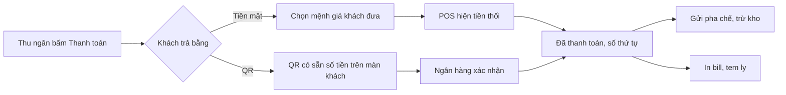

> **Mã:** DE06-TN04-PRD · **Trạng thái:** đã chốt · **Người viết:** Design · **SRS:** [SRS.md](SRS.md)

# PRD Thanh toán và in bill (Quản lý đơn hàng quán trà sữa)

## 1. Bối cảnh và vấn đề

### 1.1 Bối cảnh

Sau khi nhập đơn ([TN02](../TN02-tao-don-tai-quay/PRD.md)), thu ngân thu tiền. Quán nhận tiền mặt và chuyển khoản qua mã QR. Thanh toán xong, đơn mới được gửi tới pha chế ([TN03](../TN03-man-pha-che/PRD.md)) và in bill, tem dán ly. Đây là bước liên quan trực tiếp tới tiền của quán, nên vừa phải nhanh vừa phải khớp sổ cuối ca.

### 1.2 Vấn đề

| **Vấn đề** | **Hệ quả** |
| --- | --- |
| Tính tiền thối bằng tay | Thối sai, lệch két cuối ca |
| Khách chuyển khoản, đưa ảnh màn hình | Không chắc tiền đã vào, dễ bị lừa ảnh giả |
| Mã QR tĩnh, khách tự nhập số tiền | Nhập sai số, chuyển thiếu |
| Không có tem ly | Pha chế, khách nhầm ly khi đơn nhiều |
| Huỷ đơn không có quy trình | Thất thoát, không biết ai huỷ |
| Máy in hết giấy giữa giờ cao điểm | Không có bill, pha chế không có tem |

### 1.3 Mục tiêu

- Thanh toán tiền mặt trong ≤ 10 giây, QR trong ≤ 30 giây kể từ khi khách quét.
- 100% giao dịch QR được xác nhận tự động từ ngân hàng, không dựa vào ảnh chụp.
- Chênh lệch két cuối ca ≤ 0,1% doanh thu tiền mặt.

## 2. Người dùng

| **Nhóm** | **Nhu cầu với tính năng này** |
| --- | --- |
| Thu ngân | Biết ngay phải thối bao nhiêu; biết chắc QR đã nhận tiền |
| Quản lý ca | Duyệt huỷ đơn, hoàn tiền; biết ai đã huỷ gì |
| Khách | Quét QR có sẵn số tiền; có bill và tem ly đúng tên |

## 3. Phạm vi

### 3.1 Trong phạm vi (MVP)

- Phương thức: Tiền mặt, Chuyển khoản QR động (có số tiền và mã đơn).
- Tiền mặt: gợi ý mệnh giá khách đưa, tính tiền thối.
- QR: hiện mã trên màn khách và POS, xác nhận tự động qua thông báo của ngân hàng hoặc cổng thanh toán.
- Thanh toán xong: cấp số thứ tự, gửi đơn tới pha chế, trừ kho, in bill và tem ly.
- In lại bill, tem ly.
- Huỷ đơn đã thanh toán và hoàn tiền (tiền mặt hoặc chuyển khoản lại), cần PIN quản lý ca.

### 3.2 Ngoài phạm vi

- Quẹt thẻ ngân hàng, ví điện tử khác → phase sau.
- Chia hoá đơn, thanh toán nhiều phương thức cho một đơn. Ngoại lệ duy nhất: khách chuyển khoản thiếu được bù phần còn thiếu bằng tiền mặt.
- Hoá đơn điện tử VAT.
- Tiền tip.

## 4. Nguyên tắc sản phẩm

### 4.1 Máy tính tiền, người thu tiền

POS tính tổng, tiền thối, và đối chiếu QR. Thu ngân không phải tính nhẩm.

### 4.2 Chỉ tin xác nhận từ ngân hàng

Đơn QR chỉ thành Đã thanh toán khi hệ thống nhận được xác nhận đúng số tiền, đúng mã đơn. Ảnh chụp màn hình của khách không có giá trị.

### 4.3 Thanh toán xong là pha chế biết

Không có bước thủ công nào giữa lúc nhận tiền và lúc đơn tới quầy pha chế.

### 4.4 Huỷ có người chịu trách nhiệm

Huỷ đơn đã thanh toán cần PIN quản lý ca và lý do; mọi lần huỷ đều có nhật ký.

## 5. Quy tắc nghiệp vụ

| **Quy tắc** | **Giá trị** |
| --- | --- |
| Gợi ý mệnh giá | Số tiền đúng, và 3 mệnh giá tròn gần nhất (ví dụ tổng 47.000 → 50.000, 100.000, 200.000) |
| QR động | Chứa số tiền và mã đơn; hết hạn sau 10 phút |
| Xác nhận QR | Đúng mã đơn và số tiền ≥ tổng; chuyển dư → ghi nhận dư để hoàn |
| Không nhận được xác nhận | Sau 2 phút, gợi ý kiểm tra lại hoặc đổi sang tiền mặt |
| Số thứ tự | Cấp khi thanh toán thành công; tăng dần, bắt đầu lại từ 1 khi mở ca đầu tiên của ngày |
| Huỷ đơn đã thanh toán | Cần PIN quản lý ca, lý do; hoàn tiền theo phương thức đã trả |
| Không huỷ được | Đơn Đã giao quá 30 phút |
| In | Bill 1 bản cho khách; mỗi ly 1 tem |

- Các giá trị trên là **cấu hình theo quán**, không cố định trong code.

## 6. Luồng trải nghiệm

| **Bước** | **Giai đoạn** | **Trải nghiệm** | **Đầu ra** |
| --- | --- | --- | --- |
| 1 | Chọn phương thức | Màn thanh toán: tổng lớn, hai nút Tiền mặt, QR | Phương thức |
| 2a | Tiền mặt | Chạm mệnh giá gợi ý hoặc nhập số; tiền thối hiện to | Thu đủ tiền |
| 2b | QR | QR hiện trên màn khách; POS chờ xác nhận, có đồng hồ | Xác nhận từ ngân hàng |
| 3 | Hoàn tất | Số thứ tự hiện to; tự in bill và tem; về màn bán hàng | Đơn Đã thanh toán |
| 4 | Huỷ (khi cần) | Chọn đơn trong ca → Huỷ → PIN quản lý → lý do → hoàn tiền | Đơn Đã huỷ |

## 7. Use Cases, User Stories và Acceptance Criteria

### UC1. Thanh toán tiền mặt

#### US1.1 Thu tiền và thối tiền

User Story: Là thu ngân, tôi muốn POS tính tiền thối để không thối sai.

AC01: Màn thanh toán hiện tổng tiền lớn và các mệnh giá gợi ý.

AC02: Chạm mệnh giá → tiền thối hiện to; nhập số tiền khác bằng bàn phím số.

AC03: Tiền khách đưa < tổng → không cho hoàn tất.

AC04: Bấm "Hoàn tất" → đơn Đã thanh toán, in bill, tem, về màn bán hàng.

### UC2. Thanh toán QR

#### US2.1 Khách quét và thanh toán

User Story: Là thu ngân, tôi muốn biết chắc tiền đã vào tài khoản quán mà không cần xem màn hình của khách.

AC01: QR động có số tiền và nội dung là mã đơn; hiện trên màn khách (hoặc xoay POS về phía khách).

AC02: POS hiện "Đang chờ thanh toán" và đồng hồ đếm.

AC03: Nhận xác nhận đúng mã đơn, đủ số tiền → tự chuyển Đã thanh toán, âm báo, in bill.

AC04: Sau 2 phút chưa có xác nhận → gợi ý "Kiểm tra lại" hoặc "Đổi sang tiền mặt"; không cho đánh dấu đã thanh toán bằng tay.

AC05: Khách chuyển dư → ghi nhận, báo thu ngân để hoàn phần dư; chuyển thiếu → báo số còn thiếu; khách chuyển thêm hoặc bù phần thiếu bằng tiền mặt.

AC06: QR hết hạn sau 10 phút → tạo QR mới.

### UC3. In bill và tem ly

AC01: Bill gồm tên quán, số thứ tự, giờ, thu ngân, các dòng (món, size, tuỳ chọn khác chuẩn, số lượng, giá), giảm giá, tổng, phương thức, tiền khách đưa, tiền thối.

AC02: Tem ly gồm số thứ tự, "{x}/{y}", tên món, size, tuỳ chọn khác chuẩn, ghi chú, Tại quán hoặc Mang đi.

AC03: Máy in lỗi, hết giấy → báo trên POS, đơn vẫn hoàn tất; in lại được từ danh sách đơn trong ca.

### UC4. Huỷ đơn và hoàn tiền

#### US4.1 Huỷ đơn đã thanh toán

User Story: Là quản lý ca, tôi muốn huỷ đơn khi khách đổi ý hoặc quán làm sai, và mọi lần huỷ đều được ghi lại.

AC01: Từ đơn trong ca, chọn Huỷ đơn → nhập PIN quản lý ca → chọn lý do.

AC02: Tiền mặt → POS hiện số tiền phải trả lại khách; QR → tạo yêu cầu hoàn chuyển khoản, quản lý xác nhận đã chuyển.

AC03: Đơn huỷ → báo màn pha chế ngay (TN03); hoàn kho nếu chưa pha (TN05).

AC04: Không huỷ được đơn đã giao quá 30 phút.

## 8. Chỉ số theo dõi

| **Chỉ số** | **Định nghĩa** | **Mục tiêu MVP** |
| --- | --- | --- |
| Thời gian thanh toán tiền mặt | Từ mở màn thanh toán tới hoàn tất | ≤ 10 giây (trung vị) |
| Thời gian xác nhận QR | Từ hiện QR tới nhận xác nhận | ≤ 30 giây (trung vị) |
| Tỉ lệ QR không xác nhận | QR quá 2 phút chưa xác nhận / QR tạo | ≤ 3% |
| Tỉ lệ huỷ đơn | Đơn huỷ / đơn thanh toán | ≤ 1% |
| Chênh lệch két | Chênh lệch tiền mặt khi chốt ca / doanh thu tiền mặt | ≤ 0,1% |
| Lỗi máy in | Lần in lỗi / lần in | Theo dõi |

## 9. Phụ thuộc và rủi ro

| **Mục** | **Mô tả** | **Hướng xử lý** |
| --- | --- | --- |
| Đối tác xác nhận chuyển khoản | Chậm, mất thông báo | Đối soát định kỳ; nút Kiểm tra lại gọi tra cứu giao dịch |
| Mất mạng | Không tạo QR, không nhận xác nhận | Chỉ tiền mặt khi ngoại tuyến; đồng bộ sau |
| Ảnh chụp giả | Khách đưa ảnh chuyển khoản giả | Không có nút đánh dấu thủ công đã nhận QR |
| Máy in | Hết giấy, kẹt giấy | Báo ngay; in lại; màn pha chế vẫn nhận đơn |
| Huỷ để rút tiền | Nhân viên huỷ đơn tiền mặt rồi giữ tiền | PIN quản lý, nhật ký, báo cáo huỷ theo người (TN05) |

## 10. Câu hỏi mở

> Mọi câu hỏi dưới đây đã được PO chốt ngày 13/11/2026; quyết định ghi sau mỗi câu và đã cập nhật vào SRS.

- Khi mất mạng có cho QR tĩnh và quản lý xác nhận thủ công không? → **Đã chốt:** Không. Ngoại tuyến chỉ nhận tiền mặt (SRS BR-42).
- Hoàn tiền QR làm trong app hay ngoài app ngân hàng? → **Đã chốt:** Ngoài app: quản lý ca chuyển khoản qua ngân hàng rồi bấm "Đã hoàn" (SRS BR-44).
- Có cần màn khách riêng để hiện QR, hay xoay POS? → **Đã chốt:** QR hiện trên tablet màn khách và trên POS.
- Có cần in bill tuỳ chọn (khách không cần thì không in)? → **Đã chốt:** Có. Công tắc "In bill" trên màn thanh toán, tem ly luôn in (SRS BR-41).
