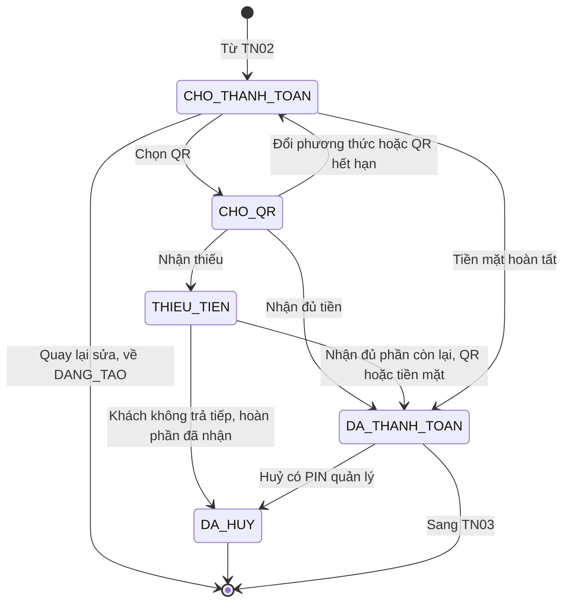
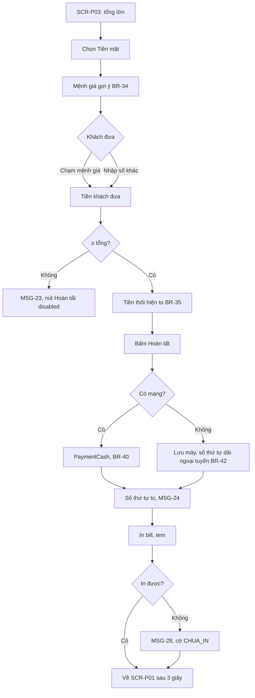
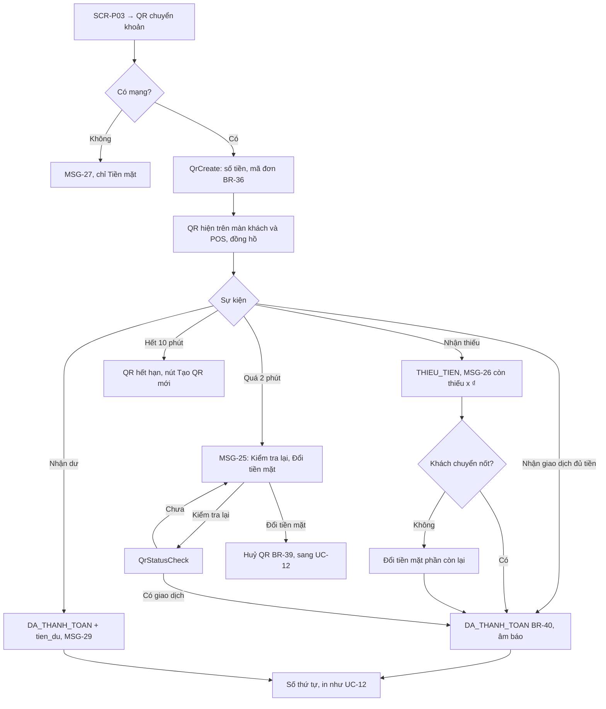
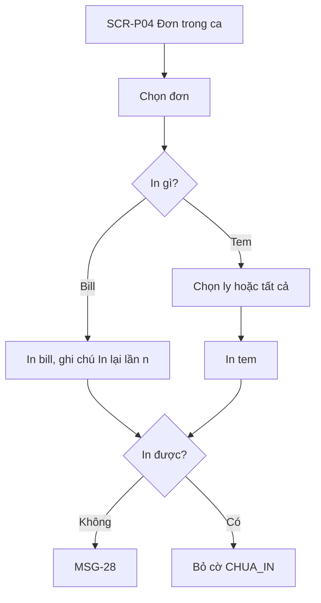
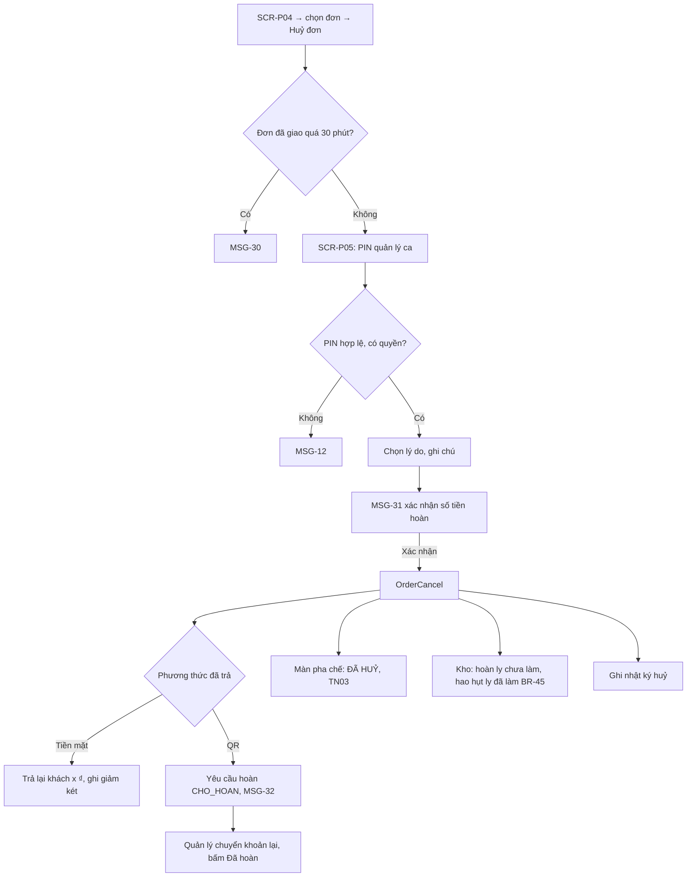
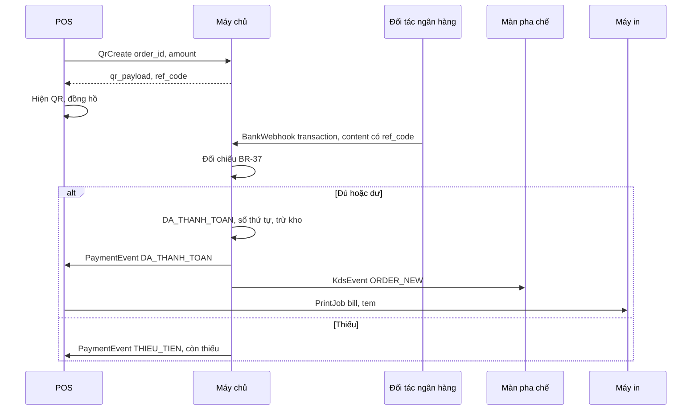

> **Mã:** DE06-TN04-SRS · **Trạng thái:** nháp · **Người viết:** Design (mock) · **PRD:** [PRD.md](PRD.md)

# UC-DE06-04 - Thanh toán và in bill

> **Bản mock.** Giá trị `[giả định]` cần BA xác nhận. SRS này mô tả đơn từ `CHO_THANH_TOAN` tới `DA_THANH_TOAN`, và mọi đường vào `DA_HUY` sau khi đã thanh toán.

## 1. Tổng quan

| **Mục** | **Nội dung** |
| --- | --- |
| Mục tiêu | Thu tiền mặt hoặc QR, xác nhận tự động, cấp số thứ tự, đẩy đơn sang pha chế, in bill và tem; huỷ và hoàn tiền có kiểm soát |
| Actor | Thu ngân · Quản lý ca · Khách · POS · Màn khách · Máy in · Máy chủ · Đối tác xác nhận chuyển khoản |
| Phạm vi | Màn thanh toán, tiền mặt, QR động, xác nhận, số thứ tự, in, in lại, huỷ, hoàn tiền, thanh toán ngoại tuyến |
| Ngoài phạm vi | Quẹt thẻ, ví điện tử, chia hoá đơn, nhiều phương thức một đơn (trừ bù phần QR thiếu bằng tiền mặt, BR-37), VAT, tip |
| Nền tảng | POS, Màn khách, máy in nhiệt kết nối POS `[giả định]` |
| Figma | `[chưa có]` |

## 2. User Story

| **ID** | **As a** | **I want** | **So that** |
| --- | --- | --- | --- |
| US-16 | Thu ngân | POS tính tiền thối | Không thối sai |
| US-17 | Thu ngân | QR có số tiền và được xác nhận tự động | Chắc chắn đã nhận tiền |
| US-18 | Pha chế | Có tem dán từng ly | Không nhầm ly |
| US-19 | Quản lý ca | Duyệt huỷ đơn kèm lý do | Kiểm soát thất thoát |
| US-20 | Thu ngân | Vẫn bán được khi mất mạng | Không dừng quầy |

## 3. Business Rules

| **Mã** | **Quy tắc** |
| --- | --- |
| BR-33 | **Tổng đơn** = tạm tính − giảm giá (TN02); khoá khi đơn `CHO_THANH_TOAN` |
| BR-34 | **Mệnh giá gợi ý**: số tiền đúng; mệnh giá tiền Việt Nam nhỏ nhất ≥ tổng; và 2 mệnh giá kế tiếp trong {10.000, 20.000, 50.000, 100.000, 200.000, 500.000} `[giả định]` |
| BR-35 | **Tiền mặt**: tiền khách đưa ≥ tổng; tiền thối = khách đưa − tổng |
| BR-36 | **QR động**: chuẩn QR chuyển khoản, chứa tài khoản quán, số tiền = tổng, nội dung = mã đơn 8 ký tự; hiệu lực 10 phút; mỗi đơn tối đa 1 QR còn hiệu lực |
| BR-37 | **Xác nhận QR**: nhận thông báo giao dịch có nội dung chứa mã đơn. Số tiền = tổng → `DA_THANH_TOAN`. > tổng → `DA_THANH_TOAN` + ghi `tien_du` cần hoàn. < tổng → đơn `THIEU_TIEN`, ghi số đã nhận, báo còn thiếu (MSG-26); khách chuyển thêm bằng QR mới cho số còn thiếu, hoặc bù bằng tiền mặt. Đây là ngoại lệ duy nhất của quy tắc một phương thức mỗi đơn `[giả định]`: đơn ghi hai dòng thanh toán, phần đã chuyển tính vào doanh thu QR, phần bù tính vào thu tiền mặt của ca (BR-56). Đủ tổng → `DA_THANH_TOAN`. Khách không trả tiếp → thu ngân bấm "Huỷ thanh toán" kèm PIN quản lý ca: số đã nhận ghi `tien_du` cần hoàn (`CHO_HOAN`), đơn `DA_HUY`, không cấp số thứ tự, không trừ kho |
| BR-38 | **Chờ xác nhận** quá 2 phút → hiện MSG-25 với "Kiểm tra lại" (gọi tra cứu giao dịch) và "Đổi sang tiền mặt". Không có thao tác đánh dấu QR thủ công |
| BR-39 | **Đổi phương thức** khi đang chờ QR: huỷ QR; nếu sau đó vẫn nhận tiền QR của đơn → ghi `tien_du` cần hoàn, báo quản lý ca |
| BR-40 | **Khi `DA_THANH_TOAN`**, các việc sau chạy trong một giao dịch dữ liệu duy nhất (thành công cả hoặc không ghi gì), không liên quan tới số lần khách trả tiền: cấp số thứ tự kế tiếp; số thứ tự bắt đầu lại từ 1 khi mở ca đầu tiên của ngày, không bắt đầu lại lúc 00:00, nên ca mở qua 00:00 dùng tiếp dãy số đang chạy (TN05 BR-54); ghi `paid_at`; đẩy sang màn pha chế (TN03); trừ kho theo công thức (TN05); gửi lệnh in |
| BR-41 | **In**: tem luôn in, 1 tem mỗi ly. **Bill tuỳ chọn**: công tắc "In bill" ở **SCR-P03**, mặc định bật `[giả định]`; tắt thì không in bill, in lại được sau từ **SCR-P04**. Lỗi in không chặn hoàn tất; đơn có cờ `CHUA_IN`; in lại từ **SCR-P04** |
| BR-42 | **Ngoại tuyến**: chỉ cho Tiền mặt; số thứ tự cấp trên máy theo dải riêng của máy (ví dụ máy 2: 2001…) để không trùng `[giả định]`; đơn lưu máy, đồng bộ khi có mạng; tem in ở POS thay cho màn pha chế |
| BR-43 | **Huỷ đơn đã thanh toán**: cần PIN quản lý ca (BR-08), lý do (Khách đổi ý, Làm sai món, Hết nguyên liệu, Khác + ghi chú). Không huỷ được khi `DA_GIAO` quá 30 phút `[giả định]`. Đơn thuộc **ca đã chốt** mà còn trong 30 phút: vẫn huỷ được nhưng phải có ca `DANG_MO`; khoản huỷ và hoàn tiền ghi vào ca đang mở ở mục "Huỷ đơn của ca trước", báo cáo của ca đã chốt không đổi (TN05 BR-57) |
| BR-44 | **Hoàn tiền**: tiền mặt → POS hiện số tiền trả lại, ghi giảm két; QR → tạo yêu cầu hoàn `CHO_HOAN`, quản lý ca chuyển khoản ngoài hệ thống rồi bấm "Đã hoàn" |
| BR-45 | **Hoàn kho khi huỷ**: ly chưa `XONG` → hoàn nguyên liệu; ly đã `XONG` → ghi hao hụt (TN05). Mọi lần huỷ ghi nhật ký: đơn, người huỷ, người duyệt, lý do, số tiền |

## 4. Trạng thái

### 4.1 Trạng thái thanh toán



### 4.2 Trạng thái hoàn tiền

`KHONG_CAN` · `CHO_HOAN` (QR, tiền dư) → `DA_HOAN` · tiền mặt hoàn ngay → `DA_HOAN`.

## 5. Use Case

### UC-12 Thanh toán tiền mặt

| **Mục** | **Nội dung** |
| --- | --- |
| Tiền điều kiện | Đơn `CHO_THANH_TOAN` |
| Hậu điều kiện thành công | Đơn `DA_THANH_TOAN`; số thứ tự; đẩy pha chế; trừ kho; in |
| Hậu điều kiện thất bại | Đơn `CHO_THANH_TOAN` |



**Luồng chính**

| **Bước** | **Actor** | **Mô tả** |
| --- | --- | --- |
| 1 | Thu ngân | Ở **SCR-P03**, chọn Tiền mặt |
| 2 | Hệ thống | Hiện mệnh giá gợi ý (BR-34) |
| 3 | Thu ngân | Chạm mệnh giá hoặc nhập số tiền khách đưa |
| 4 | Hệ thống | Tiền đưa ≥ tổng → hiện tiền thối cỡ lớn (BR-35) |
| 5 | Thu ngân | Bấm Hoàn tất |
| 6 | Hệ thống | Gọi \[PaymentCash\] (BR-40): đơn `DA_THANH_TOAN`, cấp số thứ tự, MSG-24 |
| 7 | Hệ thống | In bill và tem; về **SCR-P01** sau 3 giây |

**Luồng thay thế**

| **Mã** | **Điều kiện** | **Xử lý** |
| --- | --- | --- |
| A1 | Đang mất mạng | Lưu trên máy, cấp số thứ tự từ dải ngoại tuyến (BR-42); đồng bộ khi có mạng |

**Luồng lỗi**

| **Mã** | **Điều kiện** | **Xử lý** |
| --- | --- | --- |
| E1 | Tiền khách đưa chưa đủ | MSG-23, nút Hoàn tất disabled |
| E2 | Máy in lỗi hoặc hết giấy | MSG-28, gắn cờ `CHUA_IN`; đơn vẫn hoàn tất |

### UC-13 Thanh toán QR

| **Mục** | **Nội dung** |
| --- | --- |
| Tiền điều kiện | Đơn `CHO_THANH_TOAN`; POS có mạng |
| Hậu điều kiện thành công | Đơn `DA_THANH_TOAN` theo xác nhận của đối tác |
| Hậu điều kiện thất bại | Đơn `CHO_THANH_TOAN`; QR bị huỷ |



**Luồng chính**

| **Bước** | **Actor** | **Mô tả** |
| --- | --- | --- |
| 1 | Thu ngân | Chọn "QR chuyển khoản" ở **SCR-P03** |
| 2 | POS | Gọi \[QrCreate\]; hiện QR trên màn khách và POS |
| 3 | Khách | Quét bằng app ngân hàng; số tiền, nội dung đã điền sẵn; xác nhận |
| 4 | Đối tác | Gửi thông báo giao dịch tới máy chủ |
| 5 | Máy chủ | Đối chiếu theo BR-37; đủ → `DA_THANH_TOAN`, thực hiện BR-40 |
| 6 | POS | Nhận sự kiện, âm báo, hiện số thứ tự, in |

**Luồng thay thế**

| **Mã** | **Điều kiện** | **Xử lý** |
| --- | --- | --- |
| A1 | Khách chuyển dư | `tien_du`; MSG-29 cho thu ngân; tạo yêu cầu hoàn `CHO_HOAN` |
| A2 | Khách chuyển thiếu | `THIEU_TIEN`; MSG-26; khách chuyển thêm (QR mới với số còn thiếu) hoặc bù tiền mặt phần còn lại, ghi thành dòng thanh toán thứ hai (BR-37) |
| A3 | Quá 2 phút | MSG-25 (BR-38) |
| A4 | Đổi sang tiền mặt | Huỷ QR (BR-39) |
| A5 | QR hết hạn | Tạo QR mới, QR cũ bị vô hiệu |
| A6 | Khách chuyển thiếu rồi không trả tiếp | Thu ngân bấm "Huỷ thanh toán", nhập PIN quản lý ca; số đã nhận thành `tien_du` cần hoàn (`CHO_HOAN`); đơn `DA_HUY` (BR-37). Nhờ vậy ca vẫn chốt được theo BR-55 |

**Luồng lỗi**

| **Mã** | **Điều kiện** | **Xử lý** |
| --- | --- | --- |
| E1 | Mất mạng | MSG-27, chỉ Tiền mặt |
| E2 | Giao dịch tới sau khi đã đổi tiền mặt | Ghi `tien_du` = toàn bộ số chuyển; báo quản lý ca hoàn tiền |

### UC-14 In lại bill, tem

| **Mục** | **Nội dung** |
| --- | --- |
| Tiền điều kiện | Đơn đã `DA_THANH_TOAN` trở đi, thuộc ca đang mở |
| Hậu điều kiện | Bill hoặc tem được in lại kèm ghi chú "In lại lần n"; bỏ cờ `CHUA_IN` nếu có |



**Luồng chính**

| **Bước** | **Actor** | **Mô tả** |
| --- | --- | --- |
| 1 | Thu ngân | Mở **SCR-P04** Đơn trong ca, chọn đơn |
| 2 | Thu ngân | Chọn in lại Bill |
| 3 | Hệ thống | In bill kèm ghi chú "In lại lần n" |
| 4 | Hệ thống | Bỏ cờ `CHUA_IN` nếu có |

**Luồng thay thế**

| **Mã** | **Điều kiện** | **Xử lý** |
| --- | --- | --- |
| A1 | Chọn in lại Tem | Chọn một ly hoặc tất cả, rồi in tem |

**Luồng lỗi**

| **Mã** | **Điều kiện** | **Xử lý** |
| --- | --- | --- |
| E1 | Máy in lỗi hoặc hết giấy | MSG-28; giữ cờ `CHUA_IN` |

### UC-15 Huỷ đơn và hoàn tiền

| **Mục** | **Nội dung** |
| --- | --- |
| Tiền điều kiện | Đơn `DA_THANH_TOAN`, `DANG_PHA_CHE`, `SAN_SANG`, hoặc `DA_GIAO` ≤ 30 phút |
| Hậu điều kiện | Đơn `DA_HUY`; tiền hoàn hoặc chờ hoàn; kho hoàn hoặc ghi hao hụt; nhật ký |



**Luồng chính**

| **Bước** | **Actor** | **Mô tả** |
| --- | --- | --- |
| 1 | Thu ngân | **SCR-P04** → chọn đơn → Huỷ đơn |
| 2 | Quản lý ca | Nhập PIN ở **SCR-P05** |
| 3 | Thu ngân | Chọn lý do, ghi chú |
| 4 | Hệ thống | MSG-31 xác nhận số tiền hoàn |
| 5 | Thu ngân | Xác nhận |
| 6 | Hệ thống | Gọi \[OrderCancel\]: đơn `DA_HUY`, ghi nhật ký huỷ |
| 7 | Hệ thống | Đơn trả tiền mặt → trả lại khách, ghi giảm két |
| 8 | Hệ thống | Màn pha chế hiện "ĐÃ HUỶ" (SRS TN03); kho hoàn ly chưa làm, ghi hao hụt ly đã làm (BR-45) |

**Luồng thay thế**

| **Mã** | **Điều kiện** | **Xử lý** |
| --- | --- | --- |
| A1 | Đơn trả bằng QR | Tạo yêu cầu hoàn `CHO_HOAN`, MSG-32; quản lý chuyển khoản lại rồi bấm Đã hoàn |
| A2 | Đơn `THIEU_TIEN`, khách không trả tiếp | Thu ngân bấm Huỷ thanh toán kèm PIN quản lý ca; số đã nhận thành `tien_du` cần hoàn; đơn `DA_HUY` (BR-37) |

**Luồng lỗi**

| **Mã** | **Điều kiện** | **Xử lý** |
| --- | --- | --- |
| E1 | Đơn đã giao quá 30 phút | MSG-30, không huỷ được |
| E2 | PIN sai hoặc không đủ quyền | MSG-12 (SRS TN02) |

## 6. Điểm vào

| **Điểm vào** | **Dẫn tới** | **Ghi chú** |
| --- | --- | --- |
| "Thanh toán {tổng}" ở **SCR-P01** | **SCR-P03** | SRS TN02 |
| "Quay lại sửa" ở **SCR-P03** | Đơn về `DANG_TAO` | Huỷ QR nếu có |
| **SCR-P04** → Đơn trong ca | UC-14, UC-15 | |
| Danh sách "Chờ hoàn" ở **SCR-P04** | Hoàn QR | Quản lý ca |

## 7. Mô tả màn hình

### SCR-P03 Thanh toán (POS)

| **#** | **Thành phần** | **Loại** | **Hành vi** |
| --- | --- | --- | --- |
| 1 | Tóm tắt đơn | Panel trái | Các dòng, giảm giá, tổng (≥ 40 px), hình thức |
| 2 | Phương thức | Buttons lớn | Tiền mặt · QR chuyển khoản (disabled khi ngoại tuyến, MSG-27) |
| 3 | Mệnh giá | Grid | BR-34; bàn phím số cho số khác |
| 4 | Tiền thối | Số lớn | "Thối lại: {x} ₫" |
| 5 | QR | Panel | Mã QR, số tiền, mã đơn, đồng hồ 10 phút, trạng thái "Đang chờ thanh toán"; Kiểm tra lại, Đổi tiền mặt |
| 6 | Hoàn tất | Button lớn | Chỉ ở Tiền mặt, khi tiền đưa ≥ tổng |
| 7 | Quay lại sửa | Button text | |
| 7b | In bill | Toggle | Mặc định bật; tắt thì chỉ in tem (BR-41) |
| 8 | Màn thành công | Overlay | Số thứ tự (≥ 80 px), tiền thối, trạng thái in; tự đóng 3 giây |

### SCR-P05 Huỷ đơn & hoàn tiền (POS)

| **#** | **Thành phần** | **Loại** | **Bắt buộc** | **Hành vi** |
| --- | --- | --- | --- | --- |
| 1 | Thông tin đơn | Card | – | Số thứ tự, giờ, tổng, phương thức, trạng thái pha chế |
| 2 | PIN quản lý ca | PIN pad | Có | BR-43 |
| 3 | Lý do | Radio + ghi chú | Có | Khác → ghi chú bắt buộc |
| 4 | Hoàn tiền | Text | – | Tiền mặt: "Trả lại khách {x} ₫"; QR: "Cần chuyển khoản lại {x} ₫" |
| 5 | Xác nhận huỷ | Button đỏ | – | MSG-31 |

### Bill và tem ly (mẫu in)

```text
TRÀ SỮA {TÊN QUÁN}            Tem ly
Số: 128   12/11/2026 14:05    ┌────────────────────────┐
Thu ngân: Lan  · Mang đi      │ #128      2/3  MANG ĐI │
--------------------------    │ Trà sữa trân châu  L   │
Trà sữa trân châu L  x2 90.000│ • 50% đường • Ít đá    │
  • 50% đường                 │ • Thêm trân châu x2    │
Trà đào M            x1 35.000│ Ghi chú: tách topping  │
--------------------------    └────────────────────────┘
Tạm tính            125.000
Giảm giá              -5.000
TỔNG                120.000
Tiền mặt            200.000
Thối lại             80.000
```

## 8. API

| **API** | **Request chính** | **Response chính** | **Timeout / retry** `[giả định]` |
| --- | --- | --- | --- |
| \[PaymentCash\] | order_id, tendered, request_id | status, order_number, change | 5s / gửi lại cùng request_id; ngoại tuyến lưu máy |
| \[QrCreate\] | order_id, amount | qr_payload, ref_code, expires_at | 5s / 2 lần |
| \[BankWebhook\] (đối tác → máy chủ) | transaction_id, amount, content, time | – | Idempotent theo transaction_id |
| \[QrStatusCheck\] | order_id | Giao dịch tìm thấy hoặc không | 8s / 1 lần |
| \[PaymentEvent\] (máy chủ → POS, màn khách) | order_id, status, order_number, received, surplus | – | Kết nối realtime |
| \[PrintJob\] (POS → máy in) | type (BILL, LABEL), payload | ok, error | 5s / 1 lần |
| \[OrderCancel\] | order_id, manager_pin, reason, note | status `DA_HUY`, refund, stock_adjust | 5s / 2 lần |
| \[RefundMarkDone\] | refund_id, manager_pin | status `DA_HOAN` | 5s / 2 lần |
| \[OfflineOrdersSync\] | Danh sách đơn ngoại tuyến | Kết quả từng đơn | 15s / tự gửi lại |



**Map lỗi → thông báo**

| **Nhóm lỗi** | **Message** |
| --- | --- |
| Tiền khách đưa chưa đủ | MSG-23 |
| Chưa nhận được thanh toán QR, quá thời gian chờ | MSG-25 |
| Nhận thiếu tiền | MSG-26 |
| Nhận dư tiền | MSG-29 |
| Mất mạng | MSG-27 |
| Máy in lỗi hoặc hết giấy | MSG-28 |
| Huỷ đơn đã giao quá 30 phút | MSG-30 |
| PIN quản lý ca sai hoặc không đủ quyền | MSG-12 (SRS TN02) |

## 9. Danh sách thông báo

| **ID** | **Nơi hiện** | **Nội dung (VI)** |
| --- | --- | --- |
| MSG-23 | Inline | Tiền khách đưa chưa đủ |
| MSG-24 | Overlay | Số {n} · Thối lại {x} ₫ |
| MSG-25 | Panel QR | Chưa nhận được thanh toán. \[Kiểm tra lại\] \[Đổi sang tiền mặt\] |
| MSG-26 | Panel QR | Đã nhận {a} ₫, còn thiếu {b} ₫. \[QR phần còn lại\] \[Thu tiền mặt\] |
| MSG-27 | Inline | Đang ngoại tuyến, chỉ nhận tiền mặt |
| MSG-28 | Toast | Máy in lỗi hoặc hết giấy. Đơn đã lưu, bạn có thể in lại trong Đơn trong ca |
| MSG-29 | Popup | Khách chuyển dư {x} ₫. Đã tạo yêu cầu hoàn phần dư cho quản lý ca |
| MSG-30 | Inline | Đơn đã giao quá 30 phút nên không thể huỷ |
| MSG-31 | Popup | Huỷ đơn số {n} và hoàn {x} ₫ cho khách? \[Quay lại\] \[Huỷ đơn\] |
| MSG-32 | Toast | Đã tạo yêu cầu hoàn {x} ₫ qua chuyển khoản. Đánh dấu "Đã hoàn" sau khi chuyển |
| MSG-33 | Banner POS | Có {n} đơn ngoại tuyến chưa đồng bộ |
| MSG-34 | Toast | Đã đồng bộ {n} đơn ngoại tuyến |

MSG-12 dùng lại từ SRS TN02. Bản EN: `[chờ bổ sung]`.

## 10. Yêu cầu phi chức năng

| **Mục** | **Yêu cầu** `[giả định]` |
| --- | --- |
| Hiệu năng | Hoàn tất tiền mặt ≤ 1 giây; xử lý webhook tới POS ≤ 3 giây |
| Toàn vẹn tiền | Mỗi đơn chỉ chuyển `DA_THANH_TOAN` một lần; webhook idempotent theo transaction_id; đối soát giao dịch ngân hàng với đơn mỗi giờ |
| Bảo mật | Webhook xác thực chữ ký đối tác; không có API đánh dấu QR thủ công; PIN quản lý không lưu trên POS dạng rõ |
| Audit | Nhật ký thanh toán, huỷ, hoàn tiền giữ 5 năm |
| Offline | Tiền mặt hoạt động khi mất mạng; đồng bộ không mất, không trùng đơn |
| Tracking | Phương thức, thời gian thanh toán, QR quá 2 phút, thiếu, dư, lỗi in, huỷ (lý do, người duyệt), hoàn tiền |
| Accessibility | Tiền thối, số thứ tự cỡ lớn; trạng thái QR có chữ và âm báo |
