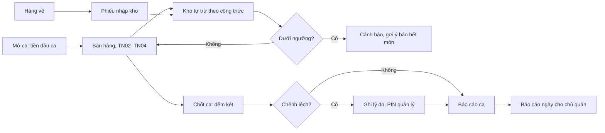

> **Mã:** DE06-TN05-PRD · **Trạng thái:** nháp · **Người viết:** Design (mock) · **SRS:** [SRS.md](SRS.md)

# PRD Kho nguyên liệu và báo cáo ca (Quản lý đơn hàng quán trà sữa)

> **Bản mock.** Con số đánh dấu `[giả định]` dùng để dựng flow, cần PO xác nhận trước khi dùng.

## 1. Bối cảnh và vấn đề

### 1.1 Bối cảnh

Mỗi ly bán ra ([TN04](../TN04-thanh-toan-in-bill/PRD.md)) dùng một lượng trà, sữa, đường, topping theo công thức ([TN01](../TN01-quan-ly-menu/PRD.md)). Chủ quán cần biết nguyên liệu còn bao nhiêu để nhập kịp, và mỗi ca bán được bao nhiêu, két có khớp không. Tính năng này lo phần "sau quầy": kho, ca làm việc, báo cáo.

### 1.2 Vấn đề

| **Vấn đề** | **Hệ quả** |
| --- | --- |
| Không biết nguyên liệu sắp hết | Hết giữa giờ cao điểm, phải báo hết món |
| Kiểm kho bằng mắt | Thất thoát, hao hụt không ai biết |
| Giao ca không đếm tiền | Thiếu tiền không biết ca nào |
| Doanh thu chỉ biết cuối tháng | Không điều chỉnh menu, nhân sự kịp |
| Không biết món nào bán chạy | Nhập sai nguyên liệu, menu dư thừa |

### 1.3 Mục tiêu

- ≥ 90% lần hết nguyên liệu được cảnh báo trước ít nhất 1 ngày `[giả định]`.
- 100% ca được chốt có đếm két và ghi chênh lệch.
- Chủ quán xem doanh thu hôm nay trong ≤ 5 giây từ lúc mở Web `[giả định]`.

## 2. Người dùng

| **Nhóm** | **Nhu cầu với tính năng này** |
| --- | --- |
| Chủ quán | Tồn kho, cảnh báo, báo cáo doanh thu, món bán chạy, chênh lệch két |
| Quản lý ca | Mở ca với tiền đầu ca, chốt ca đếm két, nhập kho khi hàng tới |
| Thu ngân | Mở, chốt ca nhanh khi không có quản lý |

## 3. Phạm vi

### 3.1 Trong phạm vi (MVP)

- Danh sách nguyên liệu: tên, đơn vị, tồn hiện tại, ngưỡng cảnh báo.
- Trừ kho tự động theo công thức khi đơn thanh toán; hoàn khi huỷ ly chưa làm.
- Cảnh báo sắp hết, hết; gợi ý báo hết món liên quan.
- Nhập kho (phiếu nhập), điều chỉnh hao hụt, kiểm kê định kỳ.
- Mở ca (tiền đầu ca), chốt ca (đếm két theo mệnh giá, chênh lệch, lý do).
- Báo cáo ca và ngày: doanh thu theo phương thức, số đơn, số ly, giảm giá, huỷ, món bán chạy, theo giờ.

### 3.2 Ngoài phạm vi

- Quản lý nhà cung cấp, đặt hàng tự động.
- Giá vốn, lợi nhuận theo món → phase sau.
- Hạn sử dụng theo lô.
- Báo cáo nhiều chi nhánh.

## 4. Nguyên tắc sản phẩm

### 4.1 Kho tự chạy theo bán hàng

Bán là trừ, huỷ là hoàn. Nhân viên chỉ thao tác khi nhập hàng và kiểm kê.

### 4.2 Báo trước khi hết

Cảnh báo khi tồn xuống dưới ngưỡng, kèm danh sách món sẽ bị ảnh hưởng.

### 4.3 Mỗi ca tự chịu trách nhiệm

Ca mở với số tiền đầu ca, chốt với số tiền đếm thực tế. Chênh lệch luôn được ghi tên người chốt và lý do.

### 4.4 Con số chủ quán cần, ngay trang đầu

Doanh thu hôm nay, số ly, so với cùng ngày tuần trước. Chi tiết ở bên dưới.

## 5. Quy tắc nghiệp vụ

| **Quy tắc** | **Giá trị** `[giả định]` |
| --- | --- |
| Đơn vị | gram, ml, cái; nhập theo đơn vị mua (thùng, hộp) quy đổi sang đơn vị dùng |
| Trừ kho | Khi đơn Đã thanh toán, theo công thức của size và tuỳ chọn |
| Hoàn kho | Ly chưa pha khi huỷ; ly đã pha ghi hao hụt |
| Ngưỡng cảnh báo | Mỗi nguyên liệu tự đặt; mặc định bằng lượng dùng trung bình 1 ngày |
| Tồn âm | Cho phép (kho trên hệ thống lệch thực tế), cảnh báo đỏ |
| Kiểm kê | Nhập số đếm thực tế; chênh lệch ghi thành điều chỉnh |
| Ca | Một ca mở mỗi quán tại một thời điểm |
| Chốt ca | Đếm két theo mệnh giá; chênh lệch > 50.000 ₫ bắt buộc lý do và PIN quản lý |

- Các giá trị trên là **cấu hình theo quán**, không cố định trong code.

## 6. Luồng trải nghiệm

| **Bước** | **Giai đoạn** | **Trải nghiệm** | **Đầu ra** |
| --- | --- | --- | --- |
| 1 | Mở ca | Nhập tiền đầu ca trên POS | Ca mở |
| 2 | Trong ca | Kho trừ tự động; cảnh báo khi sắp hết | Tồn kho cập nhật |
| 3 | Nhập hàng | Phiếu nhập: nguyên liệu, số lượng theo đơn vị mua | Tồn tăng |
| 4 | Kiểm kê | Đếm thực tế, nhập số, hệ thống ghi chênh lệch | Tồn khớp thực tế |
| 5 | Chốt ca | Đếm két theo mệnh giá; xử lý đơn giữ còn lại | Báo cáo ca |
| 6 | Xem báo cáo | Chủ quán mở Web: doanh thu, ly, món bán chạy | Ra quyết định |

## 7. Use Cases, User Stories và Acceptance Criteria

### UC1. Kho

#### US1.1 Theo dõi tồn kho

User Story: Là chủ quán, tôi muốn biết nguyên liệu còn bao nhiêu và cái nào sắp hết để nhập kịp.

AC01: Danh sách nguyên liệu: tên, tồn, đơn vị, ngưỡng, trạng thái (Đủ, Sắp hết, Hết, Âm), dự kiến dùng đủ mấy ngày.

AC02: Sắp hết → cảnh báo trên Web và POS quản lý ca, kèm danh sách món dùng nguyên liệu đó.

AC03: Hết → gợi ý một chạm báo hết các món liên quan (TN01).

AC04: Lịch sử biến động từng nguyên liệu: bán, huỷ, nhập, điều chỉnh, kiểm kê.

#### US1.2 Nhập kho

User Story: Là quản lý ca, tôi muốn nhập kho nhanh để tồn khớp thực tế.

AC01: Phiếu nhập gồm nhiều dòng: nguyên liệu, số lượng theo đơn vị mua, quy đổi tự động.

AC02: Lưu phiếu → tồn tăng ngay, ghi người nhập, thời gian.

AC03: Sửa phiếu đã lưu chỉ trong ngày, cần PIN chủ quán.

#### US1.3 Kiểm kê và điều chỉnh

User Story: Là quản lý ca, tôi muốn kiểm kê và ghi hao hụt để tồn hệ thống khớp số đếm thực tế.

AC01: Kiểm kê: chọn nguyên liệu, nhập số đếm thực tế; hiện chênh lệch so với tồn hệ thống.

AC02: Xác nhận → tồn đặt bằng số đếm, chênh lệch ghi thành điều chỉnh có lý do.

AC03: Ghi hao hụt riêng (đổ vỡ, hỏng) có lý do.

### UC2. Ca làm việc

#### US2.1 Mở ca

User Story: Là quản lý ca, tôi muốn mở ca và nhập tiền đầu ca để cuối ca biết có lệch tiền không.

AC01: Đầu ngày POS yêu cầu mở ca; nhập tiền đầu ca.

AC02: Mở ca → món, tuỳ chọn hết của hôm trước tự bật lại (TN01).

#### US2.2 Chốt ca

User Story: Là quản lý ca, tôi muốn đếm két và biết ngay có lệch không trước khi giao ca.

AC01: Còn đơn giữ hoặc đơn QR chờ → phải xử lý trước khi chốt.

AC02: Đếm két theo mệnh giá; hệ thống tính tiền mặt dự kiến = đầu ca + thu tiền mặt − hoàn tiền mặt.

AC03: Hiện chênh lệch; > 50.000 ₫ cần lý do và PIN quản lý.

AC04: Chốt xong in và lưu báo cáo ca; ca mới mở được ngay.

### UC3. Báo cáo

#### US3.1 Báo cáo ngày

User Story: Là chủ quán, tôi muốn xem doanh thu, món bán chạy trong ngày để ra quyết định kinh doanh.

AC01: Trang đầu Web: doanh thu hôm nay, số đơn, số ly, so với cùng ngày tuần trước.

AC02: Doanh thu theo phương thức, theo giờ, theo ca; giảm giá; huỷ (số đơn, tiền, người duyệt).

AC03: Top món và topping bán chạy theo số ly.

AC04: Chọn khoảng ngày; xuất CSV.

## 8. Chỉ số theo dõi `[giả định]`

| **Chỉ số** | **Định nghĩa** | **Mục tiêu MVP** |
| --- | --- | --- |
| Cảnh báo trước khi hết | Lần hết có cảnh báo trước ≥ 1 ngày / lần hết | ≥ 90% |
| Tỉ lệ ca có đếm két | Ca chốt có nhập đếm / ca chốt | 100% |
| Chênh lệch két | Tổng chênh lệch / doanh thu tiền mặt | ≤ 0,1% |
| Chênh lệch kiểm kê | Giá trị điều chỉnh khi kiểm kê / lượng dùng | Theo dõi; cao là dấu hiệu công thức sai hoặc thất thoát |
| Tần suất xem báo cáo | Lượt chủ quán mở báo cáo mỗi tuần | Theo dõi |

## 9. Phụ thuộc và rủi ro

| **Mục** | **Mô tả** | **Hướng xử lý** |
| --- | --- | --- |
| Công thức sai, thiếu | Kho lệch thực tế | Cảnh báo món thiếu công thức (TN01); kiểm kê định kỳ |
| Pha chế làm khác công thức | Kho lệch | Theo dõi chênh lệch kiểm kê theo nguyên liệu |
| Đơn ngoại tuyến | Kho chưa trừ, báo cáo thiếu | Đồng bộ trước khi chốt ca; báo đơn chưa đồng bộ |
| Quên chốt ca | Ca dài nhiều ngày | Nhắc khi qua 00:00 mà ca còn mở |

## 10. Câu hỏi mở

- Có cho nhiều ca chồng nhau (2 thu ngân, 2 két) không?
- Tồn âm có chặn bán món không?
- Ngưỡng chênh lệch két 50.000 ₫ có phù hợp?
- Báo cáo có cần giá vốn ngay ở MVP?
