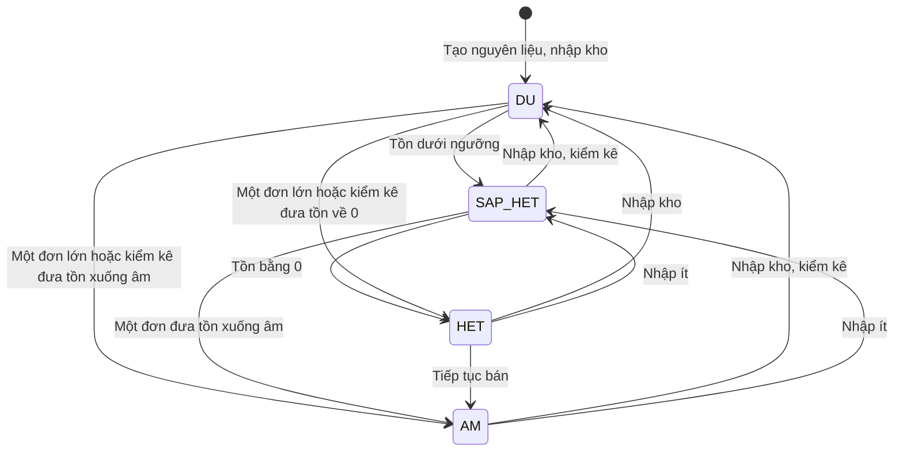
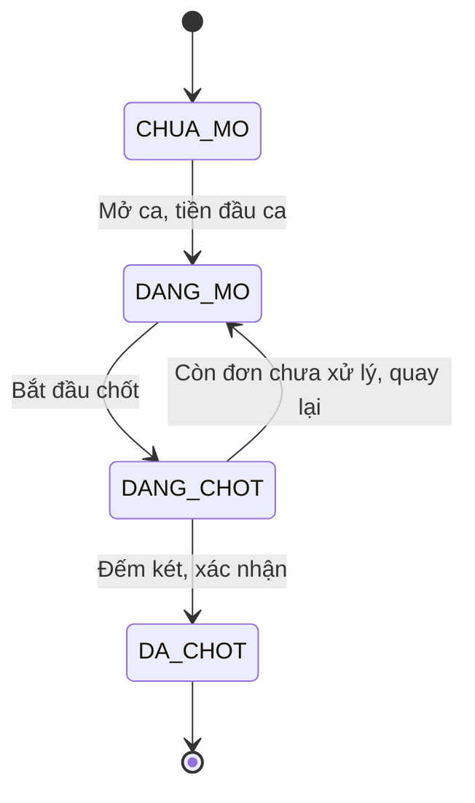
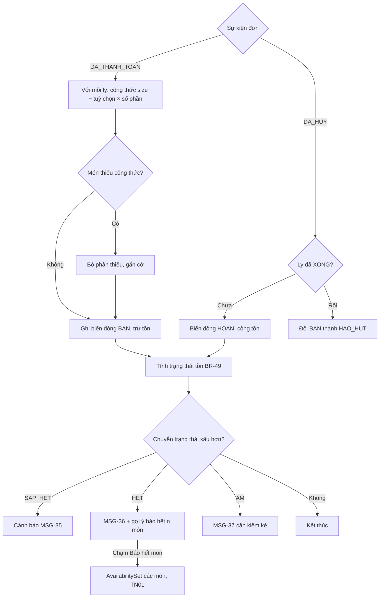
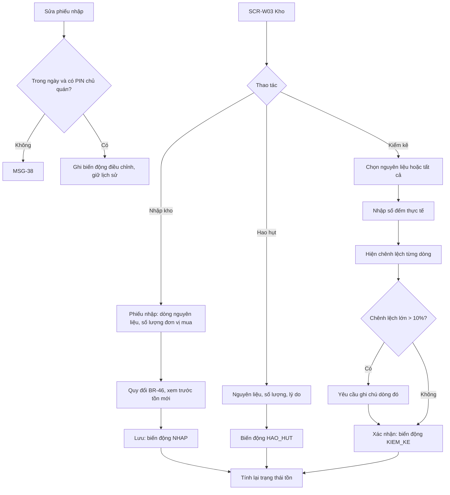
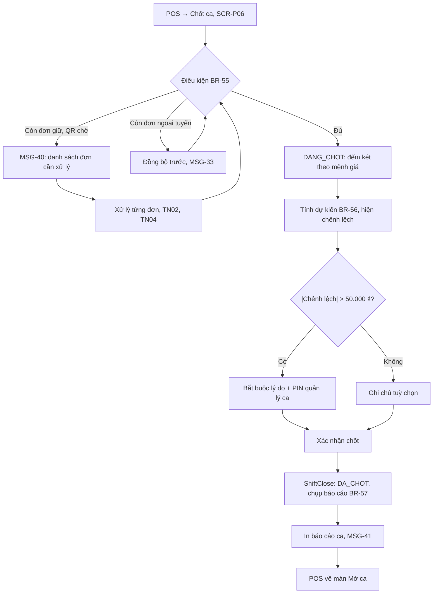
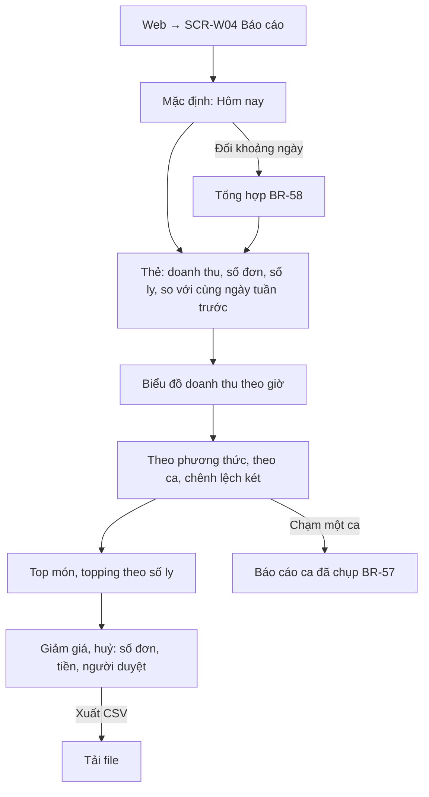
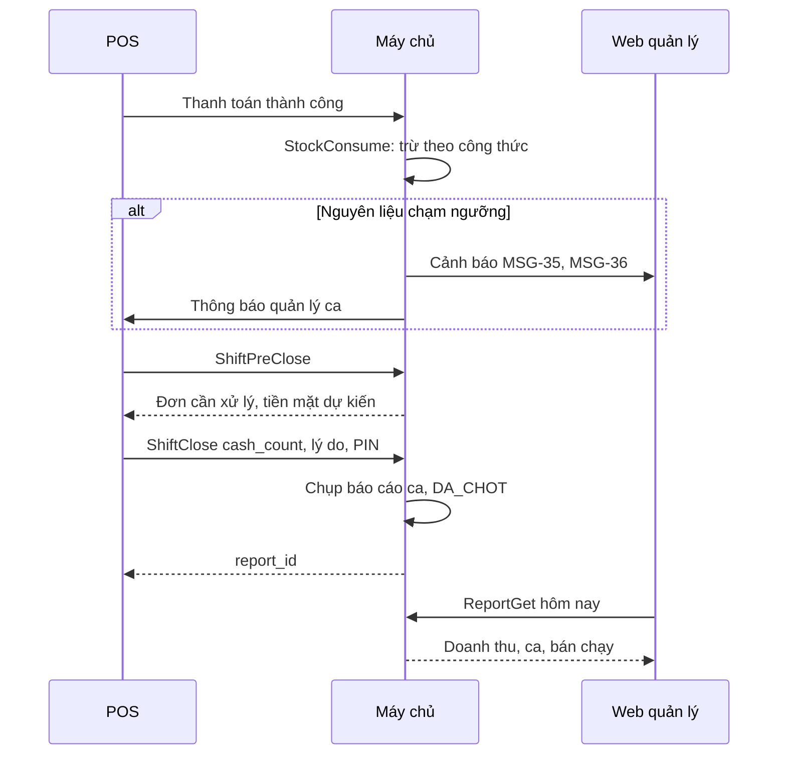

> **Mã:** DE06-TN05-SRS · **Trạng thái:** nháp · **Người viết:** Design (mock) · **PRD:** [PRD.md](PRD.md)

# UC-DE06-05 - Kho nguyên liệu và báo cáo ca

> **Bản mock.** Giá trị `[giả định]` cần BA xác nhận. Công thức xem [SRS TN01](../TN01-quan-ly-menu/SRS.md); thanh toán, huỷ xem [SRS TN04](../TN04-thanh-toan-in-bill/SRS.md).

## 1. Tổng quan

| **Mục** | **Nội dung** |
| --- | --- |
| Mục tiêu | Tồn kho tự cập nhật theo bán hàng; nhập kho, kiểm kê; mở, chốt ca có đếm két; báo cáo ca, ngày |
| Actor | Chủ quán · Quản lý ca · Thu ngân · POS · Web quản lý · Máy chủ |
| Phạm vi | Nguyên liệu, trừ và hoàn kho, cảnh báo, nhập kho, hao hụt, kiểm kê, mở ca, chốt ca, báo cáo |
| Ngoài phạm vi | Nhà cung cấp, đặt hàng tự động, giá vốn, lô và hạn dùng, nhiều chi nhánh |
| Nền tảng | Web quản lý; POS (mở, chốt ca, nhập kho nhanh) `[giả định]` |
| Figma | `[chưa có]` |

## 2. User Story

| **ID** | **As a** | **I want** | **So that** |
| --- | --- | --- | --- |
| US-21 | Chủ quán | Tồn kho tự trừ theo đơn | Không phải ghi tay |
| US-22 | Chủ quán | Được cảnh báo nguyên liệu sắp hết | Nhập kịp |
| US-23 | Quản lý ca | Nhập kho, kiểm kê nhanh | Tồn khớp thực tế |
| US-24 | Quản lý ca | Mở, chốt ca và đếm két | Biết ca có lệch tiền không |
| US-25 | Chủ quán | Xem doanh thu, món bán chạy | Ra quyết định kinh doanh |

## 3. Business Rules

| **Mã** | **Quy tắc** |
| --- | --- |
| BR-46 | **Nguyên liệu**: tên (không trùng), đơn vị dùng (g, ml, cái), đơn vị mua và hệ số quy đổi (ví dụ 1 thùng = 12.000 ml), ngưỡng cảnh báo |
| BR-47 | **Trừ kho** khi đơn `DA_THANH_TOAN`: với mỗi ly, cộng công thức size (BR-06) và công thức × số phần của từng lựa chọn; ghi biến động loại `BAN`. Món thiếu công thức → bỏ qua phần đó, ghi cờ |
| BR-48 | **Huỷ đơn** (BR-45): ly chưa `XONG` → biến động `HOAN`; ly đã `XONG` → biến động `HAO_HUT` (đổi loại từ `BAN`, tồn không đổi) |
| BR-49 | **Trạng thái tồn**: `DU` (≥ ngưỡng), `SAP_HET` (0 < tồn < ngưỡng), `HET` (tồn = 0), `AM` (tồn < 0). Ngưỡng mặc định = lượng dùng trung bình 1 ngày của 7 ngày gần nhất `[giả định]` |
| BR-50 | **Dự kiến đủ dùng** = tồn / lượng dùng trung bình ngày (7 ngày gần nhất), làm tròn xuống, đơn vị ngày |
| BR-51 | **Cảnh báo** khi chuyển sang `SAP_HET`, `HET` hoặc `AM`: banner Web, thông báo POS quản lý ca; mỗi nguyên liệu một lần mỗi trạng thái mỗi ngày. `HET` kèm gợi ý báo hết các món dùng nguyên liệu (UC-03 của TN01) |
| BR-52 | **Phiếu nhập**: ≥ 1 dòng; số lượng > 0 theo đơn vị mua; quy đổi theo BR-46; biến động `NHAP`. Sửa phiếu chỉ trong ngày tạo và cần PIN chủ quán |
| BR-53 | **Kiểm kê**: nhập số đếm thực tế; chênh lệch = đếm − tồn hệ thống; xác nhận → biến động `KIEM_KE` bằng chênh lệch. **Hao hụt thủ công**: số lượng, lý do (Đổ vỡ, Hỏng, Khác) → `HAO_HUT` |
| BR-54 | **Ca**: mỗi quán tối đa 1 ca `DANG_MO`. Mở ca cần tiền đầu ca (≥ 0). Mở ca → chạy tự bật lại `HET_MON`, `HET` (BR-07) |
| BR-55 | **Điều kiện chốt ca**: không còn đơn `TAM_GIU`, `CHO_THANH_TOAN`, `CHO_QR`, `THIEU_TIEN`; không còn đơn ngoại tuyến chưa đồng bộ |
| BR-56 | **Tiền mặt dự kiến** = tiền đầu ca + thu tiền mặt − tiền thối đã tính trong thu tiền mặt (ghi theo số tổng đơn) − hoàn tiền mặt. **Chênh lệch** = đếm thực tế − dự kiến. \|Chênh lệch\| > 50.000 ₫ → bắt buộc lý do và PIN quản lý ca `[giả định]` |
| BR-57 | **Báo cáo ca**: doanh thu theo phương thức, số đơn, số ly, giảm giá, đơn huỷ (số, tiền, người duyệt), tiền dư QR chờ hoàn, chênh lệch két. Lưu bản chụp, không đổi sau khi chốt |
| BR-58 | **Báo cáo ngày, khoảng ngày**: tổng hợp từ các ca; doanh thu theo giờ; top 10 món, top 5 topping theo số ly; so với cùng ngày tuần trước. Xuất CSV |

## 4. Trạng thái

### 4.1 Trạng thái tồn của nguyên liệu

### 4.2 Trạng thái ca

## 5. Use Case

### UC-16 Trừ kho và cảnh báo

| **Mục** | **Nội dung** |
| --- | --- |
| Tiền điều kiện | Đơn chuyển `DA_THANH_TOAN` hoặc `DA_HUY` |
| Hậu điều kiện | Tồn cập nhật; biến động ghi nhận; cảnh báo nếu chạm ngưỡng |

### UC-17 Nhập kho, hao hụt, kiểm kê

| **Mục** | **Nội dung** |
| --- | --- |
| Tiền điều kiện | Quản lý ca hoặc chủ quán đăng nhập |
| Hậu điều kiện | Tồn cập nhật; biến động có người thực hiện, lý do |

### UC-18 Mở ca

| **Mục** | **Nội dung** |
| --- | --- |
| Tiền điều kiện | Nhân viên đã đăng nhập POS; ca `CHUA_MO`; ca trước đã `DA_CHOT` |
| Hậu điều kiện | Ca `DANG_MO` với tiền đầu ca; món, tuỳ chọn hết của hôm trước bật lại (SRS TN01) |

| **Bước** | **Actor** | **Mô tả** |
| --- | --- | --- |
| 1 | Thu ngân, quản lý ca | Đăng nhập POS khi chưa có ca `DANG_MO` → **SCR-P06** chế độ Mở ca |
| 2 | Người mở ca | Nhập tiền đầu ca |
| 3 | Máy chủ | Tạo ca `DANG_MO` (BR-54); bật lại món, tuỳ chọn hết; POS vào **SCR-P01** |

**Luồng thay thế**

| **Mã** | **Điều kiện** | **Xử lý** |
| --- | --- | --- |
| A1 | Đã có ca `DANG_MO` ở máy khác | Máy này tham gia ca đang mở, không mở ca mới |
| A2 | Ca hôm trước chưa chốt | MSG-39: phải chốt ca cũ trước |

### UC-19 Chốt ca

| **Mục** | **Nội dung** |
| --- | --- |
| Tiền điều kiện | Ca `DANG_MO` |
| Hậu điều kiện thành công | Ca `DA_CHOT`; báo cáo ca lưu và in |
| Hậu điều kiện thất bại | Ca `DANG_MO` |

**Luồng chính**

| **Bước** | **Actor** | **Mô tả** |
| --- | --- | --- |
| 1 | Quản lý ca | POS → "Chốt ca" |
| 2 | POS | Kiểm tra BR-55; đủ điều kiện → **SCR-P06** chế độ đếm két |
| 3 | Quản lý ca | Nhập số tờ từng mệnh giá |
| 4 | POS | Tính tổng đếm, dự kiến, chênh lệch (BR-56) |
| 5 | Quản lý ca | Ghi lý do và PIN nếu cần; bấm "Chốt ca" |
| 6 | Máy chủ | Ca `DA_CHOT`; lưu báo cáo ca (BR-57) |
| 7 | POS | In báo cáo ca; về chế độ Mở ca |

### UC-20 Xem báo cáo

| **Mục** | **Nội dung** |
| --- | --- |
| Tiền điều kiện | Chủ quán đăng nhập Web quản lý |
| Hậu điều kiện | Không thay đổi dữ liệu; báo cáo ca đã chốt là bản chụp (BR-57) |

## 6. Điểm vào

| **Điểm vào** | **Dẫn tới** | **Ghi chú** |
| --- | --- | --- |
| Web → Kho | **SCR-W03**, UC-17 | |
| Cảnh báo kho trên Web, POS | **SCR-W03** lọc nguyên liệu đó | |
| Đăng nhập POS khi chưa có ca | UC-18, **SCR-P06** | |
| POS → menu → Chốt ca | UC-19, **SCR-P06** | |
| POS → menu → Nhập kho nhanh | UC-17 (nhập kho) | Quản lý ca |
| Web → trang chủ, Báo cáo | UC-20, **SCR-W04** | |

## 7. Mô tả màn hình

### SCR-W03 Kho (Web)

| **#** | **Thành phần** | **Loại** | **Hành vi** |
| --- | --- | --- | --- |
| 1 | Cảnh báo | Banner | Số nguyên liệu Sắp hết, Hết, Âm; chạm để lọc |
| 2 | Bảng nguyên liệu | Table | Tên, tồn + đơn vị, ngưỡng, trạng thái (chữ + màu), "Đủ dùng {n} ngày", món sử dụng |
| 3 | Hành động | Buttons | Nhập kho · Ghi hao hụt · Kiểm kê · Thêm nguyên liệu |
| 4 | Lịch sử biến động | Drawer | Theo nguyên liệu: thời gian, loại (Bán, Hoàn, Nhập, Hao hụt, Kiểm kê), số lượng, người, đơn liên quan |

### SCR-P06 Mở ca, chốt ca (POS)

| **#** | **Thành phần** | **Loại** | **Hành vi** |
| --- | --- | --- | --- |
| 1 | Chế độ Mở ca | Form | Tiền đầu ca (bàn phím số), người mở ca |
| 2 | Danh sách cần xử lý | List | Đơn giữ, QR chờ, đơn ngoại tuyến (BR-55); chạm để xử lý |
| 3 | Đếm két | Bảng mệnh giá | 500.000 … 1.000 ₫: số tờ, thành tiền; tổng đếm |
| 4 | Đối chiếu | Card | Tiền đầu ca, thu tiền mặt, hoàn tiền mặt, dự kiến, chênh lệch (dương: thừa, âm: thiếu, có chữ) |
| 5 | Lý do, PIN | Form | Khi vượt ngưỡng BR-56 |
| 6 | Tóm tắt ca | Card | Doanh thu theo phương thức, số đơn, số ly, huỷ |
| 7 | Chốt ca | Button | In báo cáo ca |

### SCR-W04 Báo cáo ca, ngày (Web)

| **#** | **Thành phần** | **Loại** | **Hành vi** |
| --- | --- | --- | --- |
| 1 | Khoảng ngày | Date range | Hôm nay (mặc định), Hôm qua, 7 ngày, Tháng này, Tuỳ chọn |
| 2 | Thẻ số liệu | Stat cards | Doanh thu, Số đơn, Số ly, Giá trị đơn trung bình; so với cùng kỳ |
| 3 | Theo giờ | Bar chart | Doanh thu mỗi giờ |
| 4 | Theo phương thức | Table | Tiền mặt, QR: số đơn, tiền |
| 5 | Theo ca | Table | Ca, người mở, chốt, doanh thu, chênh lệch két; chạm xem báo cáo ca |
| 6 | Bán chạy | Table | Top 10 món, top 5 topping theo số ly |
| 7 | Giảm giá, huỷ | Table | Số đơn, tiền, lý do, người duyệt |
| 8 | Xuất CSV | Button | BR-58 |

## 8. API

| **API** | **Request chính** | **Response chính** | **Timeout / retry** `[giả định]` |
| --- | --- | --- | --- |
| \[StockConsume\] (nội bộ, khi thanh toán, huỷ) | order_id, event | Biến động, trạng thái tồn mới, cảnh báo | Chạy trong giao dịch thanh toán, huỷ |
| \[StockList\] | store_id, filter | Nguyên liệu, tồn, trạng thái, đủ dùng | 3s / 1 lần |
| \[StockReceive\] | lines, note | receipt_id, tồn mới | 5s / 2 lần |
| \[StockAdjust\] | type (HAO_HUT, KIEM_KE), lines, reason | Biến động | 5s / 2 lần |
| \[StockMovements\] | ingredient_id, range | Lịch sử | 3s / 1 lần |
| \[ShiftOpen\] | store_id, opening_cash, staff_pin | shift_id | 3s / 2 lần |
| \[ShiftPreClose\] | shift_id | Đơn cần xử lý, số liệu dự kiến | 3s / 1 lần |
| \[ShiftClose\] | shift_id, cash_count, reason, manager_pin | report_id, status `DA_CHOT` | 5s / 2 lần |
| \[ReportGet\] | store_id, range | Số liệu BR-58 | 5s / 1 lần |
| \[ReportExport\] | store_id, range | CSV | 15s / 1 lần |

**Map lỗi → thông báo** `[giả định]`

| **Nhóm lỗi** | **Message** |
| --- | --- |
| Sửa phiếu nhập quá hạn hoặc thiếu PIN chủ quán | MSG-38 |
| Ca cũ chưa chốt | MSG-39 |
| Chốt ca khi còn đơn chưa xử lý | MSG-40 |
| Chênh lệch két vượt ngưỡng | MSG-43 |
| Tồn âm | MSG-37 |
| Xuất báo cáo thất bại | Thông báo lỗi chung của app (ngoài bộ MSG của SRS này), cho thử lại |

## 9. Danh sách thông báo

| **ID** | **Nơi hiện** | **Nội dung (VI)** |
| --- | --- | --- |
| MSG-35 | Banner Web, thông báo POS | {Nguyên liệu} sắp hết: còn {x} {đơn vị}, đủ dùng khoảng {n} ngày |
| MSG-36 | Banner Web, thông báo POS | {Nguyên liệu} đã hết. {n} món đang dùng nguyên liệu này. \[Báo hết các món\] |
| MSG-37 | Banner Web | Tồn {nguyên liệu} đang âm. Vui lòng kiểm kê lại |
| MSG-38 | Inline | Chỉ sửa được phiếu nhập trong ngày, cần PIN chủ quán |
| MSG-39 | Popup POS | Ca ngày {dd/mm} chưa được chốt. Vui lòng chốt ca cũ trước khi mở ca mới. \[Chốt ca cũ\] |
| MSG-40 | Panel **SCR-P06** | Còn {n} đơn chưa xử lý xong. Vui lòng hoàn tất hoặc huỷ trước khi chốt ca |
| MSG-41 | Toast | Đã chốt ca. Chênh lệch két: {+/−x} ₫ |
| MSG-42 | Thông báo POS | Ca đã mở qua 00:00. Hãy chốt ca hôm qua |
| MSG-43 | Inline | Chênh lệch trên 50.000 ₫. Vui lòng ghi lý do và nhập PIN quản lý ca |
| MSG-44 | Banner Web | {n} món đang thiếu công thức, kho có thể chưa chính xác. \[Xem món\] |

MSG-33 dùng lại từ SRS TN04. Bản EN: `[chờ bổ sung]`.

## 10. Yêu cầu phi chức năng

| **Mục** | **Yêu cầu** `[giả định]` |
| --- | --- |
| Hiệu năng | Trừ kho không làm chậm thanh toán quá 200 ms; **SCR-W04** hôm nay ≤ 3 giây; báo cáo 30 ngày ≤ 10 giây |
| Toàn vẹn | Trừ kho nằm trong cùng giao dịch với chuyển `DA_THANH_TOAN`; biến động kho không xoá, chỉ thêm điều chỉnh |
| Audit | Báo cáo ca chụp lại, không sửa sau khi chốt; mọi phiếu nhập, kiểm kê, hao hụt ghi người và thời gian |
| Offline | Mở ca, bán tiền mặt chạy ngoại tuyến; chốt ca cần đồng bộ (BR-55) |
| Tracking | Cảnh báo kho, báo hết từ cảnh báo, nhập kho, kiểm kê (chênh lệch), mở, chốt ca (chênh lệch két), xem, xuất báo cáo |
| Accessibility | Trạng thái tồn và chênh lệch két có chữ ("Thiếu", "Thừa"), không chỉ màu; biểu đồ có bảng số liệu thay thế |
